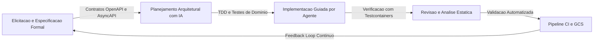

# Processo de Desenvolvimento Suportado por IA

> [!important] Requisito Oficial do Pacote 1
> *Descrição do processo de desenvolvimento suportado por IA: ciclo de desenvolvimento, ferramentas, agentes e especificações utilizadas ao longo da construção da plataforma.*
>
> Este documento formaliza o arcabouço metodológico adotado pela equipe, estabelecendo como os modelos de linguagem e agentes atuam em simbiose com as práticas consolidadas da engenharia de software para construir a plataforma [[00 - Visao Geral e Indice (MOC)|BolsoPass]].

---

## 1. Visao Geral da Abordagem Metodologica

O desenvolvimento do BolsoPass adota o paradigma de **Engenharia de Software Aumentada por IA (*AI-Augmented Software Engineering*)** estruturado sobre o princípio de **Humano no Controle (*Human-in-the-Loop - HITL*)**. 

A premissa central é que modelos de linguagem generativos, quando utilizados sem especificações formais prévias, tendem a gerar códigos sintaticamente válidos porém semanticamente frágeis — propensos a alucinações de contratos, quebras de invariantes de domínio e violações de concorrência. Para contornar essa limitação, a equipe não utiliza a inteligência artificial como um simples gerador de código isolado, mas como um **parceiro analítico de pareamento (*Pair Programming Agent*)** guiado por **Desenvolvimento Orientado a Especificação (*Specification-Driven Development*)**.

A metodologia integra práticas do [Domain-Driven Design (DDD)](https://martinfowler.com/tags/domain%20driven%20design.html) e do [Extreme Programming (XP)](https://en.wikipedia.org/wiki/Extreme_programming), combinando ciclos rápidos de feedback com restrições arquiteturais rígidas.



---

## 2. Ciclo de Desenvolvimento e Etapas

O ciclo de vida de cada funcionalidade segue cinco etapas iterativas e bem delimitadas:

### Etapa 1: Elicitacao e Especificacao Orientada a Contratos
- **Objetivo:** Estabelecer a semântica rigorosa das mensagens e interfaces antes de qualquer linha de código de produção ser escrita.
- **Papel da Engenharia e da IA:** O engenheiro de software define os objetivos de negócio e as restrições de concorrência. O agente de IA auxilia na formalização desses requisitos através da redação de especificações [OpenAPI 3.0](https://spec.openapis.org/oas/latest.html) para as rotas REST do checkout e esquemas [AsyncAPI](https://www.asyncapi.com/) para os tópicos do Kafka.
- **Especificações Utilizadas no Projeto:**
  - Contrato REST de Checkout e Reservas: arquivo `.agents/specs/openapi-checkout.yaml`, padronizando o cabeçalho `Idempotency-Key` e a resposta `HTTP 409 Conflict` para concorrência de assentos.
  - Esquemas de Mensageria Kafka: arquivo `.agents/specs/asyncapi-kafka.yaml`, padronizando os eventos `ReservaExpiradaEvent` e `PedidoPagoEvent`.
- **Relação com o Projeto:** Assegura que módulos independentes (como o Módulo de Inventário e o Módulo de Checkout, descritos em [[03 - Requisitos Funcionais (5 Modulos)]]) possuam contratos imutáveis de comunicação.

### Etapa 2: Modelagem Arquitetural e Decisoes Estruturais
- **Objetivo:** Antecipar gargalos de concorrência e mitigar o acoplamento temporal.
- **Papel da Engenharia e da IA:** Discussão técnica estruturada sobre trade-offs arquiteturais através de registros de decisão de arquitetura (*Architecture Decision Records - ADRs*). O agente atua explorando cenários de estresse — como a viabilidade de bloqueio pessimista relacional frente a travas distribuídas no Redis, ou os impactos de entrega *At-Least-Once* na duplicação de mensagens.
- **Relação com o Projeto:** Fundamenta as escolhas que sustentam as máquinas de estado detalhadas em [[06 - Maquinas de Estados e Regras de Negocio]].

### Etapa 3: Desenvolvimento Orientado a Testes de Dominio (TDD com IA)
- **Objetivo:** Garantir determinismo e atingir cobertura unitária $\ge 70\%$ nos agregados centrais do sistema, conforme preconizado em [[04 - Requisitos Nao-Funcionais (RNFs)]].
- **Papel da Engenharia e da IA:** O engenheiro guia o agente na escrita dos testes unitários da máquina de estados do pedido (`Criado` $\to$ `Reservado` $\to$ `Aguardando` $\to$ `Pago` $\to$ `Expirado`) e das regras de expiração estrita de 10 minutos. O código de produção só é gerado após a falha planejada dos testes de unidade.

### Etapa 4: Integracao de Infraestrutura com Testcontainers
- **Objetivo:** Eliminar falsos positivos decorrentes de bancos em memória (*h2/mocks*) através de validação em instâncias reais de contêineres.
- **Papel da Engenharia e da IA:** Configuração automatizada de suítes de teste de integração que sobem contêineres efêmeros de PostgreSQL, Apache Kafka e Redis utilizando a biblioteca [Testcontainers](https://testcontainers.com/). O agente cria cenários que simulam quedas intencionais do broker Kafka durante o processamento do pagamento para comprovar que o *Transactional Outbox Pattern* não perde eventos nem gera estados inconsistentes.

### Etapa 5: Revisao de Codigo, GCS e Governanca
- **Objetivo:** Manter a higiene da base de código e a conformidade com as políticas de integração contínua.
- **Papel da Engenharia e da IA:** Toda modificação é submetida via Pull Request. Agentes de IA realizam a primeira camada de revisão de código (*code review*), inspecionando vazamentos de conexões em pools relacionais, correta propagação do cabeçalho `Idempotency-Key` e aderência aos padrões de código limpo.

---

## 3. Ferramentas, Agentes e Stacks Utilizadas

| Ferramenta / Agente | Função Específica no Projeto | Modo de Interação |
| :--- | :--- | :--- |
| **Google Antigravity (AGY)** | Plataforma de orquestração de desenvolvimento agentic: scaffolding, execução de planos com `/plan` e **revisão independente** do que outro agente implementou. | CLI e IDE nativa |
| **Claude Code & Agent Skills** | Agente principal de implementação (frontend, backend, testes e documentação das versões), com verificação no navegador real (Playwright) e no Docker. Gera documentação no padrão [Agent Skills](https://agentskills.io/specification). | Extensão do VS Code e terminal |
| **OpenAI Codex** | **Revisão cruzada e auditoria de segurança** do código gerado por outro agente (ex.: achado de tomada de conta por CPF, registrado em `Segurança.md`). | Extensão do VS Code |
| **Obsidian CLI & Vault Skills** | Gestão de conhecimento do projeto, geração automatizada de notas de requisitos, story maps e rastreabilidade viva. | Extensão do vault local |
| **GitHub Copilot / Cursor** | Refatoração inline, completação de boilerplate e sugestão de queries de banco transacionais. | Inline no editor |

---

## 4. Estrutura de Agentes Especializados (Agent Skills Specification)

Para que os agentes operem com precisão contextual e sem ambiguidades conceituais, o repositório adota a especificação padrão [Agent Skills](https://agentskills.io/specification), organizando as diretrizes técnicas do projeto em diretórios modulares sob `.agents/skills/`:

```text
.agents/
├── skills/
│   ├── bolsopass-domain/      # Regras de negocio, invariantes de estoque e FSM
│   │   └── SKILL.md
│   ├── kafka-contracts/       # Esquemas de eventos, particionamento e semantica At-Least-Once
│   │   └── SKILL.md
│   ├── testing-strategy/      # Diretrizes de testes (>= 70% cobertura e Testcontainers)
│   │   └── SKILL.md
│   └── transactional-outbox/  # Padrao de implementacao para eliminacao do Dual-Write
│       └── SKILL.md
└── specs/
    ├── openapi-checkout.yaml  # Contrato OpenAPI 3.0 para rotas de reservas e checkout
    └── asyncapi-kafka.yaml    # Contrato AsyncAPI 2.6 para mensageria assincrona no Kafka
```

### Protocolo de Engenharia de Contexto e Guardrails Determinísticos
1. **Context Priming:** Antes da resolução de qualquer tarefa técnica, o agente recebe o contexto dos invariantes do sistema: tráfego em rajada (*flash crowd*), tolerância zero a sobre-venda (*zero overselling*) e expiração atômica de reservas em 10 minutos.
2. **Rejeição Automática de Anti-Padrões:** Os agentes são instruídos a recusar categoricamente implementações baseadas em escrita dupla HTTP síncrona ou ausência de tratamento de idempotência no consumo de mensagens.
3. **Geração de Artefatos Verificáveis:** Toda resposta arquitetural de um agente deve gerar testes automatizados reproduzíveis ou diagramas formais de sequência e estado.

---

## 5. Garantia de Qualidade e Prevencao de Alucinacoes

> [!tip] Diretrizes de Validacao Humana (Human-in-the-Loop)
> - **Nenhum código gerado entra em branch principal sem testes verdes:** Todo Pull Request deve ser aprovado pela suíte automatizada de testes unitários e de integração com Testcontainers.
> - **Validação Conceitual de Concorrência:** O desenho de travas distribuídas no Redis, isolamento transacional no PostgreSQL (`SERIALIZABLE` ou `SELECT ... FOR UPDATE`) e partições do Kafka é obrigatoriamente auditado e aprovado pelo time de engenharia.
> - **Rastreabilidade de Decisões:** Decisões arquiteturais fundamentadas por agentes de IA são registradas em formato de notas técnicas no cofre do Obsidian e mapeadas na [[08 - Matriz de Rastreabilidade e Pacotes de Entrega]].


---

## 6. O Processo na Pratica (Pacote 3)

As seções anteriores definem o processo. Esta registra **como ele foi aplicado** na construção do
BolsoPass, de outubro a novembro de 2026.

### 6.1 Entregas incrementais por versão

O produto foi construído em fatias pequenas. Cada versão tem um README com o escopo, as regras de
negócio, os testes e as pendências:

| Versão | Escopo |
| :--- | :--- |
| [1.0](../Versão%201.0%20-%20Implementação/README.md) | Jornada do cliente: catálogo, mapa de assentos, checkout de 10 min e ingresso com QR dinâmico |
| [2.0](../Versão%202.0%20-%20Implementação/README.md) | Administração e login único por perfil |
| [3.0](../Versão%203.0%20-%20Implementação/README.md) | Administração refeita a partir dos mockups |
| [4.0](../Versão%204.0%20-%20Implementação/README.md) | Bilheteria: leitor de QR no celular (inclusive offline) e venda no balcão |
| [5.0](../Versão%205.0%20-%20Implementação/versao5.0.md) | Plano de microsserviços conferido com o enunciado; passo 1: Outbox no Kafka real e Testcontainers |
| [5.1](../Versão%205.1%20-%20Implementação/README.md) | Cadastro público, gestão de usuários e código de ativação |

### 6.2 Ciclo de cada pedido ao agente

1. **Especificação pelo humano:** o integrante descreve a necessidade (muitas vezes com mockups) e
   as regras de negócio.
2. **Plano antes do código:** para mudanças grandes, o agente devolve um prompt estruturado, o plano
   e as decisões em aberto; **nada é alterado antes da aprovação** (Human-in-the-Loop). Exemplo: na
   versão 5.1, o grupo decidiu "um perfil por conta" e "PIN separado da senha" antes da implementação.
3. **Implementação com testes:** o código entra junto com testes de integração (backend) e de
   jornada nas telas reais (frontend).
4. **Verificação no ambiente real:** além da suíte automatizada, o agente executa a jornada no
   navegador (Playwright) contra o backend no Docker e confere as mensagens no Kafka (AKHQ).
5. **Revisão cruzada:** outro agente (Codex ou Antigravity) revisa o que foi feito, e o humano decide
   o que entra.

### 6.3 Exemplos de revisão cruzada

| Achado | Quem achou | Resultado |
| :--- | :--- | :--- |
| Conta criada no balcão podia ser assumida informando só o CPF | Codex (auditoria de segurança) | Código de ativação de 6 dígitos, 24 h, só o hash no banco |
| O commit dessa correção não compilava e o código não chegava ao cliente | Claude Code | Corrigido; tela do balcão mostra e gera o código |
| Código do pedido podia repetir com o banco cheio (erro 500 numa compra) | Claude Code, ao rodar a suíte | Sorteio confere se o código já existe |
| Venda no balcão bloqueada por reserva online pendente do mesmo cliente | Teste manual do grupo | Regra de uma reserva aberta vale só no site |

### 6.4 Números da verificação (03/11/2026)

- **Backend:** 59 testes (integração HTTP, WebSocket real, concorrência, Testcontainers com
  PostgreSQL e Kafka), **93% das linhas** cobertas (JaCoCo; o build falha abaixo de 70%).
- **Frontend:** 85 testes (domínio e jornadas completas de cliente, admin e bilheteria nas telas
  reais), **92% das linhas** cobertas (o comando de cobertura falha abaixo de 70%).
