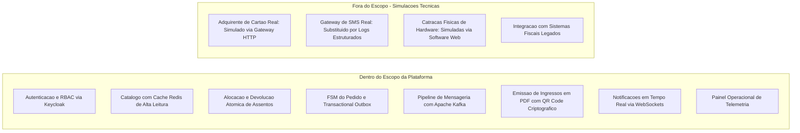

# Documento de Visao do Produto: BolsoPass

> [!abstract] Resumo Executivo
> O **BolsoPass** é uma plataforma distribuída de alta resiliência projetada para gerenciar os ciclos de reserva temporária, checkout transacional e controle de acesso a megaeventos culturais e esportivos. O produto tem como foco eliminar os pontos únicos de falha e os colapsos operacionais comuns em bilheterias convencionais durante aberturas de vendas com demanda explosiva (*flash crowd*), assegurando **zero sobre-venda**, expiração atômica de reservas em 10 minutos e emissão auditável de ingressos criptografados.

---

## 1. O Problema de Negocio

### O Cenário das Bilheterias Tradicionais
A venda de ingressos para atrações de escala massiva — como festivais de música com mais de cem mil participantes ou finais de torneios esportivos — impõe desafios transacionais ímpares à engenharia de software:

- **Colapso por Esgotamento de Conexões:** Quando um lote concorrido é liberado, centenas de milhares de clientes tentam concluir compras simultaneamente nos primeiros sessenta segundos. Plataformas convencionais estruturadas sobre chamadas síncronas retêm pools de conexão de banco de dados enquanto aguardam autorizações de adquirentes ou disparam e-mails, gerando esgotamento de conexões (*connection pool exhaustion*) e indisponibilidade sistêmica.
- **Sobre-venda e Condições de Corrida (*Overselling*):** Se o controle de estoque depender de leituras desatualizadas ou de locks relacionais amplos e mal dimensionados, dois ou mais usuários conseguem comprar exatamente o mesmo assento físico no mesmo milissegundo. Esse erro transacional acarreta danos severos à imagem pública da produtora, além de disputas judiciais e prejuízos financeiros substanciais.
- **Acoplamento Temporal e Frustração do Usuário:** Em arquiteturas síncronas, a instabilidade em um serviço terceiro (como um gateway de SMS ou um servidor de PDF) interrompe o processo de pagamento já debitado do cartão do consumidor, deixando o cliente sem confirmação e com valor cobrado.

### Quadro Síntese de Oportunidade de Produto

| Dimensão | Diagnóstico de Engenharia |
| :--- | :--- |
| **O problema de** | Colapso de infraestrutura, inconsistência de inventário e sobre-venda durante picos de tráfego de rajada (*flash crowd traffic*). |
| **Afeta** | Fãs e compradores, produtoras de eventos, operadores de controle de acesso e equipes de sustentação de tecnologia. |
| **Cujo impacto é** | Cancelamentos traumáticos de ingressos, prejuízos financeiros diretos, lentidão extrema e perda irreversível de confiança do consumidor. |
| **Uma solução de sucesso deve** | Garantir a atomicidade das reservas sem tolerar sobre-venda, isolar o checkout transacional através de mensageria assíncrona com [Apache Kafka](https://kafka.apache.org/) e disponibilizar dados em tempo real para os organizadores. |

---

## 2. Declaracao de Posicao do Produto (Product Positioning)

- **Para** produtoras de eventos de grande porte e o público consumidor de entretenimento e esportes,
- **Que necessitam** de uma experiência de compra instantânea, segura, justa e transparente no momento crítico da abertura de vendas,
- **O BolsoPass** é uma plataforma de bilhetagem e controle de acesso baseada em arquitetura de microsserviços e mensageria assíncrona orientada a eventos,
- **Que** garante matematicamente a eliminação de sobre-venda (*zero overselling*), efetua reservas temporárias com tempo de vida estrito de dez minutos com desalocação automática e emite ingressos em PDF assinados criptograficamente,
- **Diferente de** plataformas legadas monolíticas que travam sob carga concentrada devido a operações síncronas bloqueantes,
- **O nosso produto** emprega travas distribuídas atômicas no Redis, o padrão [Transactional Outbox](https://microservices.io/patterns/data/transactional-outbox.html) para comunicação confiável e uma máquina de estados finitos resiliente, descrita em [[06 - Maquinas de Estados e Regras de Negocio]].

---

## 3. Personas e Perfis de Usuarios

### Persona 1: Gabriel (Cliente Comprador)
- **Perfil:** Jovem de 24 anos, usuário experiente de smartphones, fã de música internacional que se planeja semanas antes para a abertura das vendas de festivais.
- **Dores Recorrentes:** Frustração extrema ao esperar em filas virtuais opacas, preencher dados de pagamento e, ao clicar em "concluir", deparar-se com erro de timeout ou aviso de que o ingresso já foi vendido para outro comprador.
- **Necessidades no BolsoPass:**
  - Acesso ao mapa de assentos com atualização contínua de disponibilidade sem recarregar a tela, através de WebSockets.
  - Garantia formal de que, ao reservar o assento, ele permanece retido por exatamente dez minutos para conclusão serena do pagamento.
  - Recebimento imediato do ingresso digital autenticado em seu perfil e por e-mail.
- **Jornada Mapeada:** Detalhada no documento [[05 - User Story Mapping e Backlog]].

### Persona 2: Beatriz (Organizadora de Megaeventos)
- **Perfil:** Diretora de operações de uma das maiores empresas de entretenimento do país, responsável pela produção de festivais com múltiplos palcos e capacidade para 80 mil pessoas.
- **Dores Recorrentes:** Pavor de overbooking, relatórios de vendas defasados em planilhas desconectadas e instabilidade crônica nos servidores nos primeiros minutos do lançamento oficial.
- **Necessidades no BolsoPass:**
  - Configuração autônoma de eventos, lotes de preços escalonados e mapas setoriais de assentos.
  - Acompanhamento em tempo real das métricas de conversão de ingressos por minuto e taxa de esgotamento de lotes.
  - Segurança contra fraudes de ingressos clonados ou falsificados.

### Persona 3: Marcos (Operador de Portaria e Acesso)
- **Perfil:** Fiscal de catraca e controle de acesso trabalhando na portaria de estádios em dias de jogos ou apresentações ao vivo.
- **Dores Recorrentes:** Filas quilométricas causadas por leitores lentos de ingressos ou fraudes decorrentes de impressões duplicadas de bilhetes.
- **Necessidades no BolsoPass:**
  - Leitor de ingressos ágil capaz de validar assinaturas digitais do QR Code em milissegundos.
  - Mecanismo que impeça estritamente a reutilização de ingressos já bipados (*double entry prevention*).
  - Capacidade de validar bilhetes offline caso ocorra queda temporária no link de internet do estádio.

### Persona 4: Ana (Engenheira de Confiabilidade / SRE)
- **Perfil:** Engenheira de infraestrutura responsável por manter o ecossistema estável durante janelas críticas de vendas de alta concorrência.
- **Dores Recorrentes:** Esgotamento súbito de pools de banco de dados, mensagens perdidas entre serviços e falta de observabilidade estruturada em tempo real.
- **Necessidades no BolsoPass:**
  - Arquitetura conteinerizada e reprodutível via Docker Compose para testes e homologação rápida.
  - Métricas de telemetria expostas sobre o throughput do Kafka, latência $P_{95}/P_{99}$ e consumo de filas.
  - Automação integral via esteiras de integração contínua (CI/CD) com validação rígida de testes de integração via Testcontainers.

---

## 4. Escopo do Produto e Limites do Sistema

Para assegurar foco e cumprimento dos objetivos pedagógicos e operacionais da disciplina, as fronteiras da plataforma foram explicitadas abaixo:

> [!warning] Delimitações Específicas para Avaliação Acadêmica
> - **Simulador de Gateway Financeiro:** Como adquirentes financeiras reais exigem credenciais bancárias e introduzem custos transacionais, a plataforma integra um **Simulador de Gateway Financeiro** resiliente. Esse simulador expõe rotas HTTP e webhooks capazes de reproduzir aprovações, recusas, latências variáveis e processamento com cabeçalho `Idempotency-Key`.
> - **Controle de Acesso Físico:** A leitura de catracas é atendida por uma interface web responsiva do operador, validando as assinaturas dos ingressos através de criptografia assimétrica detalhada em [[03 - Requisitos Funcionais (5 Modulos)]].

---

## 5. Criterios de Sucesso e Indicadores Chave de Desempenho (KPIs)

Para medir a eficácia operacional do BolsoPass na resolução dos problemas de negócio diagnosticados, foram estabelecidos os seguintes indicadores de sucesso:

| Indicador (KPI) | Meta Quantitativa | Impacto de Negócio |
| :--- | :--- | :--- |
| **Taxa de Sobre-venda (*Overselling Rate*)** | Exatamente $0,00\%$ | Eliminação de litígios jurídicos e frustração do consumidor por compra de assento indisponível. |
| **Precisão de TTL da Reserva** | $10\text{ min} \pm 1\text{ s}$ | Maximização da taxa de ocupação do evento sem prejudicar o tempo concedido ao comprador. |
| **Latência no Catálogo ($P_{95}$)** | $\le 50\text{ ms}$ a $5.000\text{ req/s}$ | Navegação fluida para milhares de compradores simultâneos sem queda de infraestrutura. |
| **Tempo de Validação na Portaria** | $\le 300\text{ ms}$ por ingresso | Redução drástica das filas de acesso físico nos portões do evento. |
| **Taxa de Cobrança Duplicada** | $0,00\%$ via `Idempotency-Key` | Proteção contra cobranças financeiras repetidas causadas por instabilidades de rede móvel. |

---

## 6. Matriz de Riscos de Negocio e Engenharia

| Risco Identificado | Severidade | Probabilidade | Estratégia de Mitigação Arquitetural |
| :--- | :---: | :---: | :--- |
| **Esgotamento de conexões de banco por rajada** | Crítica | Alta | Emprego de cache-aside Redis na camada de leitura e pool HikariCP dimensionado com isolamento de borda. |
| **Falha de rede entre banco relacional e Kafka** | Alta | Média | Aplicação estrita do *Transactional Outbox Pattern* com publicação assíncrona por relay worker desacoplado. |
| **Queda de conectividade na portaria física** | Alta | Alta | Validação offline de ingressos baseada na verificação da assinatura criptográfica assimétrica do QR Code via chave pública local. |
| **Retransmissão de mensagens pelo Kafka (*At-Least-Once*)** | Média | Alta | Tabela relacional `processed_messages` garantindo consumo idempotente em todos os workers de despacho. |

