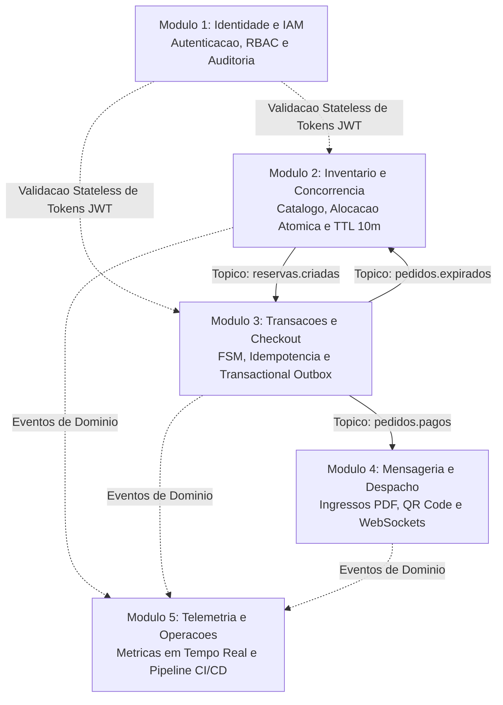

# Requisitos Funcionais por Modulo Autonomo

> [!abstract] Resumo da Arquitetura Funcional
> O escopo do [[00 - Visao Geral e Indice (MOC)|BolsoPass]] está organizado em **cinco frentes funcionais autônomas**. Cada frente foi desenhada para operar como um microsserviço com alta coesão e baixo acoplamento temporal, comunicando-se por meio de eventos assíncronos no [Apache Kafka](https://kafka.apache.org/) e APIs RESTful protegidas por tokens stateless.

---

## 1. Modulo de Identidade, Autenticacao e Autorizacao (IAM)

> [!info] Características de Integração
> - **Complexidade:** Média
> - **Responsabilidade Principal:** Prover mecanismos transversais de segurança, autenticação baseada em tokens criptograficamente assinados e controle granular de autorização para todas as rotas da plataforma.

### [RF-01] Autenticacao Stateless via JWT e Refresh Tokens em Chave-Valor
- **Por que essa decisão:** Para evitar que dezenas de milhares de requisições de clientes batam no servidor de identidade a cada chamada de API, a autenticação deve ser *stateless*. Os microsserviços downstream (Inventário e Checkout) validam o token localmente usando a chave pública do emissor (JWKS), sem realizar chamadas síncronas de rede.
- **Descrição Técnica:** O módulo emite um Access Token baseado na [RFC 7519 (JSON Web Token)](https://datatracker.ietf.org/doc/html/rfc7519) assinado digitalmente com algoritmo assimétrico (RS256 ou EdDSA), com tempo de expiração curto (15 minutos). Simultaneamente, emite um Refresh Token persistido no [Redis](https://redis.io/) com validade de 7 dias.
- **Regras de Negócio:**
  - O logout ou a renovação de credenciais revoga o Refresh Token no Redis imediatamente.
  - O uso de um Refresh Token previamente rotacionado aciona bloqueio preventivo da sessão por suspeita de reutilização maliciosa.
- **Critérios de Aceitação:** Token expirado retorna status HTTP 401 Unauthorized; rotação do token via refresh permite continuidade da navegação sem exigir nova digitação de senha.

### [RF-02] Controle de Acesso Baseado em Papeis (RBAC Granular)
- **Por que essa decisão:** A segregação de privilégios previne que clientes acessem métricas operacionais ou que operadores de portaria consigam criar eventos e lotes de ingressos.
- **Descrição Técnica:** O token JWT transporta a claim de perfis de usuário (`roles`), respeitando quatro perfis estritos:
  1. `ROLE_CLIENT`: Navega no catálogo, efetua reservas, realiza checkout e consulta seus próprios ingressos.
  2. `ROLE_ORGANIZER`: Cadastra eventos, configura lotes e mapas de assentos, e monitora relatórios de vendas.
  3. `ROLE_OPERATOR`: Executa a leitura e validação de ingressos na catraca via leitor de QR Code.
  4. `ROLE_ADMIN`: Gerencia configurações globais, credenciais de organizadores e telemetria da infraestrutura.
- **Critérios de Aceitação:** Tentativas de acesso a endpoints não autorizados para o papel do usuário retornam status HTTP 403 Forbidden.

### [RF-03] Auditoria de Credenciais e Gestao Cadastral de Organizadores
- **Descrição Técnica:** O sistema mantém trilha de auditoria para ações sensíveis de segurança (emissão de tokens, falhas repetidas de autenticação, ativação de novas contas de organizadores).
- **Regras de Negócio:** Tentativas sucessivas de autenticação incorreta ativam bloqueio temporal com rate-limiting implementado no nível do API Gateway.

---

## 2. Modulo de Catalogo, Assentos e Bloqueio Concorrente (Inventario)

> [!important] Características de Integração
> - **Complexidade:** Alta
> - **Responsabilidade Principal:** Atender tráfego com alta taxa de leitura no catálogo de eventos e orquestrar alocações com **tolerância zero a sobre-venda (*zero overselling*)**.

### [RF-04] Gestao Estruturada de Eventos, Lotes e Mapas de Assentos
- **Descrição Técnica:** Permite que organizadores cadastrem eventos (data, local, descrição), lotes com regras de preço e o mapa físico setorizado de assentos (cadeiras numeradas ou vagas nominais por setor).
- **Critérios de Aceitação:** Cada assento físico possui um identificador unívoco imutável no banco relacional.

### [RF-05] Catalogo Otimizado para Alta Leitura (Read-Heavy Cache-Aside)
- **Por que essa decisão:** No momento da abertura de vendas, a proporção de leituras no catálogo supera a de compras em uma escala de cem para um. Acessar o banco de dados diretamente para cada visualização de evento provocaria exaustão de conexões.
- **Descrição Técnica:** Os detalhes de eventos e a disponibilidade consolidada dos lotes são servidos a partir do cache Redis através do padrão *Cache-Aside*, com invalidação automática orientada por eventos de venda.
- **Critérios de Aceitação:** Consultas aos dados do catálogo respondem em tempo $P_{95} \le 50\text{ ms}$ durante picos de tráfego.

### [RF-06] Alocacao Atomica de Assentos e Travas Distribuidas (Zero Overselling)
- **Por que essa decisão:** Condições de corrida (*race conditions*) no exato segundo da liberação das vendas podem permitir que múltiplos usuários comprem a mesma vaga se a operação não for atômica.
- **Descrição Técnica:** A reserva do assento é protegida por trava distribuída atômica com tempo de vida definido no Redis (comando `SET ... NX PX 600000`) ou por transação relacional com lock pessimista (`SELECT ... FOR UPDATE`).
- **Regras de Negócio:**
  - O assento transita do estado `DISPONIVEL` para `RESERVADO_TEMPORARIO`.
  - Dispara-se o cronômetro estrito de **10 minutos** para que o usuário complete o pagamento.
  - Caso outro cliente tente alocar o mesmo assento antes da liberação, a requisição é rejeitada de imediato com HTTP 409 Conflict.
- **Critérios de Aceitação:** Em testes com concorrência de 1.000 requisições simultâneas disputando uma única cadeira, exatamente uma reserva é criada e 999 são rejeitadas.

### [RF-07] Devolucao Atomica de Assentos por Timeout de 10 Minutos ou Desistencia
- **Por que essa decisão:** Assentos reservados por compradores que abandonam o carrinho não podem ficar retidos indefinidamente, nem podem exigir rotinas manuais de limpeza.
- **Descrição Técnica:** Ao término exato de dez minutos sem confirmação de pagamento, o módulo de inventário consome o evento de expiração ou detecta a expiração da chave no Redis e retorna o assento para o estado `DISPONIVEL`.
- **Regras de Negócio:** O evento de expiração é publicado no tópico Kafka `reservas.expiradas`, permitindo que os clientes que estejam com a tela de mapa de assentos aberta vejam o assento liberado em tempo real, conforme ilustrado em [[07 - Mockups e Mapa de Navegacao Frontend]].

---

## 3. Modulo de Pedidos, Checkout e Transacoes Resilientes

> [!important] Características de Integração
> - **Complexidade:** Alta
> - **Responsabilidade Principal:** Controlar o ciclo de vida da transação financeira, gerenciar a máquina de estados do pedido e garantir publicação atômica no Kafka sem o **Dual-Write Dilemma**.

### [RF-08] Maquina de Estados Finitos (FSM) Rigorosa do Pedido
- **Por que essa decisão:** Transições anômalas (como pagar um pedido cujo prazo de 10 minutos já expirou) causam inconsistências financeiras graves entre a operadora do cartão e o inventário.
- **Descrição Técnica:** O pedido obedece estritamente às transições modeladas em [[06 - Maquinas de Estados e Regras de Negocio]]:
  $$\text{Criado} \longrightarrow \text{Reservado} \longrightarrow \text{Aguardando Pagamento} \longrightarrow \text{Pago} \mid \text{Expirado} \mid \text{Cancelado}$$
- **Critérios de Aceitação:** Transições fora da máquina de estados disparam exceção de domínio invariante e são rejeitadas.

### [RF-09] Suporte ao Cabecalho HTTP Idempotency-Key
- **Por que essa decisão:** Falhas intermitentes de conexão de rede ou usuários clicando compulsivamente no botão "Finalizar Compra" podem submeter múltiplas requisições idênticas.
- **Descrição Técnica:** O endpoint de submissão de pagamento (`POST /api/v1/checkout`) exige a presença do cabeçalho `Idempotency-Key: <UUID>`, em conformidade com o rascunho da [IETF Idempotency-Key](https://datatracker.ietf.org/doc/draft-ietf-httpapi-idempotency-key-header/).
- **Regras de Negócio:** O sistema armazena a resposta da transação no Redis associada à chave por 24 horas. Novas requisições com a mesma chave retornam o resultado original sem disparar nova cobrança financeira.

### [RF-10] Implementacao do Transactional Outbox Pattern contra o Dual-Write Dilemma
- **Por que essa decisão:** Se a aplicação comitar o pagamento no PostgreSQL e em seguida tentar enviar a mensagem ao Kafka via HTTP, uma falha de rede nesse intervalo fará o banco registrar o pagamento enquanto o Kafka nunca receberá o evento, impedindo a emissão do ingresso.
- **Descrição Técnica:** A atualização do estado do pedido para `PAGO` e a inserção do evento `PedidoPago` na tabela `outbox_events` ocorrem dentro de uma **única transação ACID local no PostgreSQL**.
- **Regras de Negócio:** Um worker independente (*Outbox Relay Worker*) lê os registros pendentes com a cláusula `SELECT ... FOR UPDATE SKIP LOCKED` e os publica no Kafka com semântica de entrega *At-Least-Once*, marcando o evento como publicado após o ACK do broker.
- **Critérios de Aceitação:** Caso o broker Kafka seja derrubado no instante do pagamento, a transação local no banco de dados permanece íntegra e o evento é despachado automaticamente assim que o cluster restabelecer conectividade.

### [RF-11] Integracao com Simulador de Gateway Financeiro
- **Descrição Técnica:** O módulo comunica-se com um simulador de pagamentos via API HTTP, permitindo injetar cenários de aprovação, recusa por saldo insuficiente e simulação de timeout de rede para validação de resiliência.

---

## 4. Modulo de Emissao de Ingressos, PDF e Notificacoes (Despacho)

> [!info] Características de Integração
> - **Complexidade:** Média-Alta
> - **Responsabilidade Principal:** Consumir eventos assíncronos de pagamentos aprovados, gerar os arquivos de ingresso em PDF criptograficamente auditáveis e notificar o usuário por múltiplos canais em tempo real.

### [RF-12] Consumo Idempotente de Eventos Kafka
- **Por que essa decisão:** Como o Kafka opera com garantia de entrega *At-Least-Once*, mensagens podem ser entregues mais de uma vez em cenários de rebalanceamento de partições ou falhas transitórias de ACK.
- **Descrição Técnica:** O consumidor do tópico `pedidos.pagos` mantém uma tabela relacional de controle (`processed_messages`). Antes de iniciar a geração do ingresso, o worker valida se o identificador do evento já foi processado. Se já existir, a mensagem é descartada sem duplicar o arquivo ou o envio.

### [RF-13] Geracao de Ingressos em PDF com Carimbo de Tempo e QR Code Criptografico
- **Descrição Técnica:** Para cada ingresso confirmado, o serviço compila um documento PDF padronizado contendo:
  - Metadados do evento, identificador do setor, número do assento e nome do comprador.
  - **Carimbo de Tempo (*Timestamp*):** Data e hora exata da emissão com hash SHA-256 para auditoria de precedência.
  - **QR Code com Assinatura Digital:** Payload contendo `ticket_id`, `event_id`, `seat_id`, `issued_at` e assinatura digital gerada com a chave privada da plataforma (algoritmo ECDSA P-256 ou RSA-PSS).
- **Critérios de Aceitação:** O operador de portaria consegue validar a autenticidade do QR Code na catraca de forma offline, necessitando apenas da chave pública da plataforma para conferir a assinatura digital.

### [RF-14] Notificacao Reativa via WebSockets e Despacho Multicanal
- **Descrição Técnica:** Imediatamente após a compilação do ingresso:
  - Publica uma notificação em canal WebSocket privado (`/ws/orders/{orderId}`) conectado ao SPA do usuário, permitindo que a interface mude de tela e exiba o ingresso sem necessidade de polling síncrono.
  - Dispara comprovante estruturado para o canal de e-mail do comprador.
- **Critérios de Aceitação:** O intervalo decorrido entre o commit do pagamento e o surgimento do ingresso na tela do usuário é $\le 1.5\text{ segundo}$.

---

## 5. Modulo de Telemetria e Operacoes (DevOps e Analytics)

> [!important] Características de Integração
> - **Complexidade:** Alta
> - **Responsabilidade Principal:** Ingerir eventos de navegação e compras, alimentar o painel analítico dos organizadores e garantir a governança do código e a orquestração dos contêineres.

### [RF-15] Ingestao Desacoplada de Eventos de Telemetria
- **Por que essa decisão:** Coletar dados de navegação e funil diretamente nos bancos transacionais geraria contenção de escrita inaceitável.
- **Descrição Técnica:** Os eventos de clique, seleção de assento, abandono de checkout e compra concluída são despachados para o tópico Kafka `telemetria.eventos`, sendo agregados de forma assíncrona para análises posteriores.

### [RF-16] Painel Analitico em Tempo Real
- **Descrição Técnica:** Disponibiliza interface administrativa com métricas atualizadas em tempo real:
  - Velocidade de esgotamento de lotes (ingressos comercializados por minuto).
  - Taxa de conversão do funil de checkout.
  - Volume de assentos devolvidos por estouro do prazo de dez minutos.
  - Latência das rotas e throughput de requisições por segundo.

### [RF-17] Orquestracao do Ambiente com Docker Compose
- **Descrição Técnica:** O repositório fornece um arquivo `docker-compose.yml` completo contendo todos os microsserviços, banco PostgreSQL com scripts de inicialização, Redis, cluster Apache Kafka (em modo KRaft ou Zookeeper), Keycloak e UI de mensageria (Kafdrop ou AKHQ).
- **Critérios de Aceitação:** O ambiente é inicializado e integrado com um único comando `docker compose up --build`.

### [RF-18] Pipeline de Integracao Continua (CI/CD)
- **Descrição Técnica:** Esteira automatizada configurada no GitHub Actions ou GitLab CI disparada a cada Pull Request ou commit na branch `develop`.
- **Regras de Negócio:** A pipeline executa linters estáticos, testes unitários com validação de cobertura $\ge 70\%$ nos agregados de domínio e testes de integração com Testcontainers reais.
