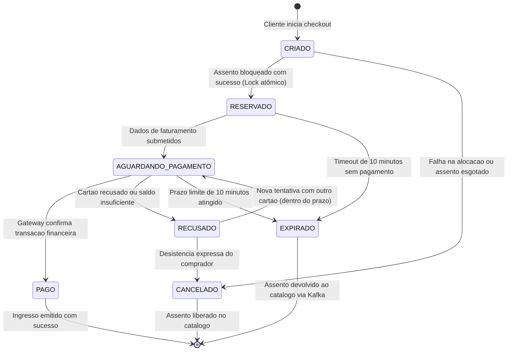
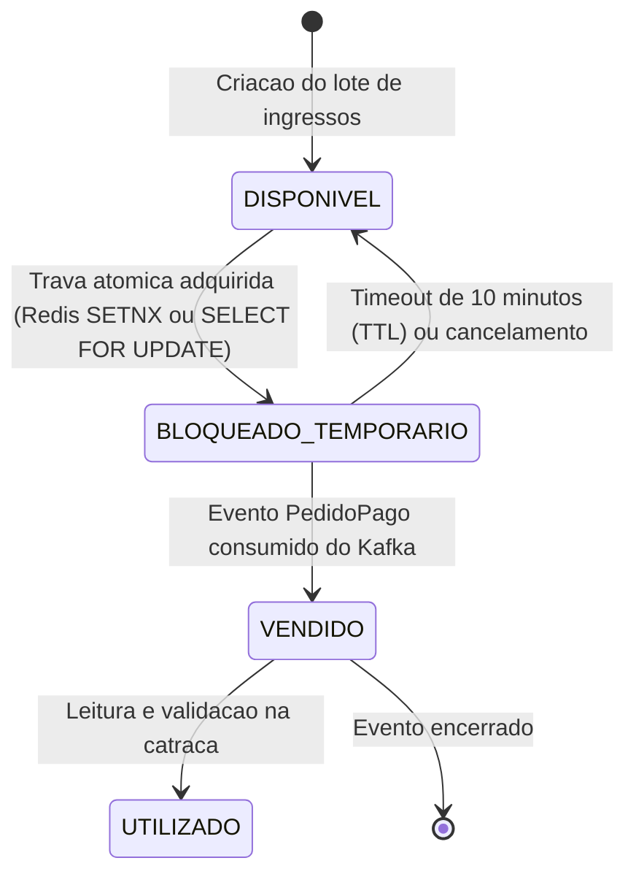
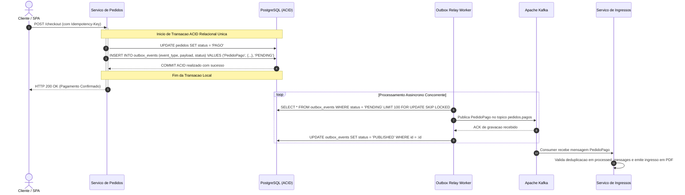

# Maquinas de Estados e Regras de Negocio Criticas

> [!important] Requisito Central de Avaliacao
> O enunciado da disciplina determina expressamente que a suíte de testes unitários automatizados cubra as máquinas de estado da plataforma com **no mínimo 70% de cobertura de domínio**. Este documento formaliza as transições válidas, os invariantes transacionais e as estratégias de resiliência adotadas no [[00 - Visao Geral e Indice (MOC)|BolsoPass]].

---

## 1. Maquina de Estados Finitos (FSM) do Pedido

No módulo de **Pedidos e Checkout**, modelar o pedido como uma Máquina de Estados Finitos (*Finite State Machine - FSM*) é indispensável para evitar que requisições concorrentes ou falhas parciais de rede deixem ordens de compra em estados intermediários indefinidos.



### Tabela Formal de Transições de Estado

| Estado Atual | Evento Disparador | Próximo Estado | Efeito Colateral Transacional e Ação de Domínio |
| :--- | :--- | :--- | :--- |
| `INEXISTENTE` | `IniciarCheckoutCommand` | `CRIADO` | Inicializa agregador do pedido, vincula `cliente_id` e itens. |
| `CRIADO` | `AssentoBloqueadoEvent` | `RESERVADO` | Associa a reserva e inicia o cronômetro estrito de dez minutos. |
| `CRIADO` | `BloqueioFalhouEvent` | `CANCELADO` | Libera recursos alocados e emite erro 409 para a camada HTTP. |
| `RESERVADO` | `SubmeterPagamentoCommand` | `AGUARDANDO_PAGAMENTO` | Dispara requisição com `Idempotency-Key` para o gateway financeiro. |
| `RESERVADO` | `Timeout10MinutosExcedido` | `EXPIRADO` | Publica `ReservaExpiradaEvent` no Kafka e desaloca o assento. |
| `AGUARDANDO_PAGAMENTO` | `PagamentoAprovadoEvent` | `PAGO` | Persiste pedido pago e grava `PedidoPagoEvent` na tabela Outbox. |
| `AGUARDANDO_PAGAMENTO` | `PagamentoRecusadoEvent` | `RECUSADO` | Permite nova tentativa de pagamento dentro do tempo restante. |
| `AGUARDANDO_PAGAMENTO` | `Timeout10MinutosExcedido` | `EXPIRADO` | Cancela a intenção de cobrança e publica evento de expiração. |
| `PAGO` | *(Qualquer Evento)* | **Transição Proibida** | Estado final imutável. Tentativas de alteração lançam `IllegalStateException`. |

---

## 2. Ciclo de Vida do Assento e da Reserva (Inventario)

O inventário opera em simetria com a FSM do Pedido para assegurar o cumprimento de **Zero Overselling**:



### Invariantes de Estoque
1. **Invariante de Exclusão Mútua:** Em nenhum momento mais de uma thread pode obter sucesso ao transicionar o assento de `DISPONIVEL` para `BLOQUEADO_TEMPORARIO`.
2. **Invariante de Conservação:** A soma de assentos disponíveis, bloqueados temporariamente e vendidos deve ser estritamente igual à capacidade do lote cadastrado.

---

## 3. Padrao Transactional Outbox (Eliminacao do Dual-Write Dilemma)

> [!important] O Problema da Escrita Dupla (Dual-Write Dilemma)
> Quando uma aplicação precisa atualizar um banco relacional e despachar uma mensagem para o Apache Kafka, executar essas duas operações de maneira sequencial síncrona gera inconsistência incontornável:
> - Se o banco efetuar commit mas o broker falhar, o pagamento foi registrado mas o evento de emissão do ingresso se perdeu.
> - Se a mensagem for publicada antes do commit e o banco sofrer rollback por violação de integridade, um ingresso é gerado sem lastro financeiro.

Para eliminar essa inconsistência de forma definitiva, a aplicação emprega o [Transactional Outbox Pattern de Chris Richardson](https://microservices.io/patterns/data/transactional-outbox.html):



### O Uso de `FOR UPDATE SKIP LOCKED`
Para evitar contenção de locks quando múltiplos workers de Outbox operam em paralelo, a query de polling utiliza a cláusula `FOR UPDATE SKIP LOCKED` nativa do [PostgreSQL](https://www.postgresql.org/docs/current/explicit-locking.html#LOCKING-ROWS). Esse recurso garante que cada worker capture um lote exclusivo de eventos sem travar ou competir com os demais workers.

---

## 4. Estrategia de Idempotencia e Deduplicacao

### Camada de Borda HTTP (`Idempotency-Key`)
Em conformidade com a especificação da [IETF para cabeçalho Idempotency-Key](https://datatracker.ietf.org/doc/draft-ietf-httpapi-idempotency-key-header/):

```http
POST /api/v1/checkout HTTP/1.1
Host: bolsopass.pucrs.br
Authorization: Bearer <JWT_TOKEN>
Idempotency-Key: 7b9e8312-d9f2-4b2a-a9e1-e63d865cfa99
Content-Type: application/json

{
  "reservation_id": "res_884192",
  "payment_method": "CREDIT_CARD",
  "installments": 1
}
```

- Quando a requisição atinge o gateway, a chave de idempotência é consultada no Redis.
- Se o estado da chave for `COMPLETED`, o gateway retorna a resposta prévia armazenada sem reprocessar a chamada nem reenviar a ordem ao gateway de pagamento.
- Se o estado for `PROCESSING`, o gateway retorna HTTP 409 Conflict para alertar que a operação já está em andamento.

### Camada de Mensageria (Deduplicação no Consumidor Kafka)
Para absorver retransmissões do broker decorrentes da garantia de entrega *At-Least-Once*, cada microsserviço consumidor mantém uma tabela de controle relacional:

```sql
CREATE TABLE processed_messages (
    message_id VARCHAR(64) PRIMARY KEY,
    consumer_group VARCHAR(64) NOT NULL,
    processed_at TIMESTAMP WITH TIME ZONE DEFAULT NOW()
);
```

Toda mensagem consumida é processada dentro de uma transação local que tenta inserir o `message_id`. Se a chave primária já existir, a transação aborta sem efeitos colaterais (*no-op idempotente*), assegurando que o ingresso não seja gerado duas vezes.
