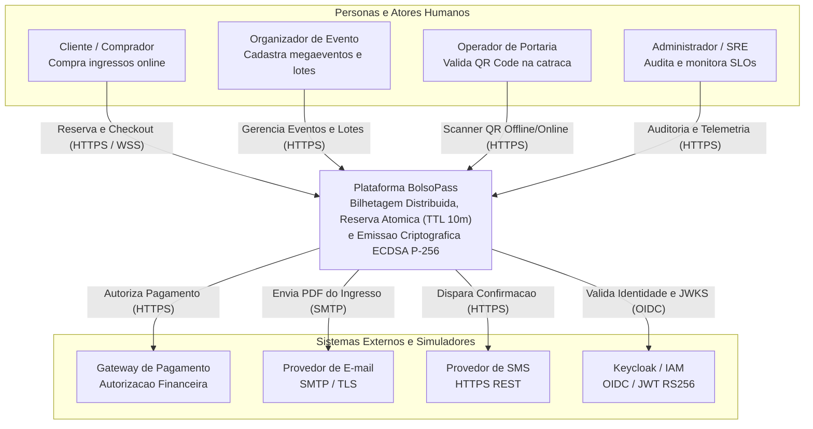
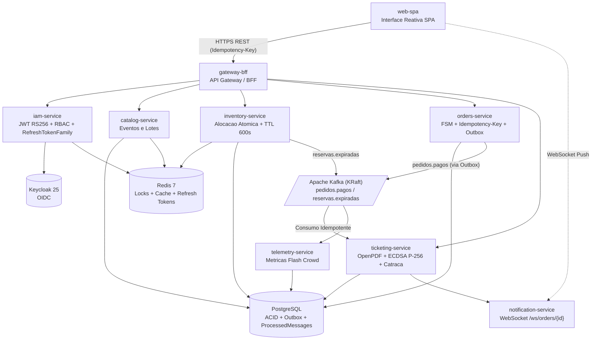
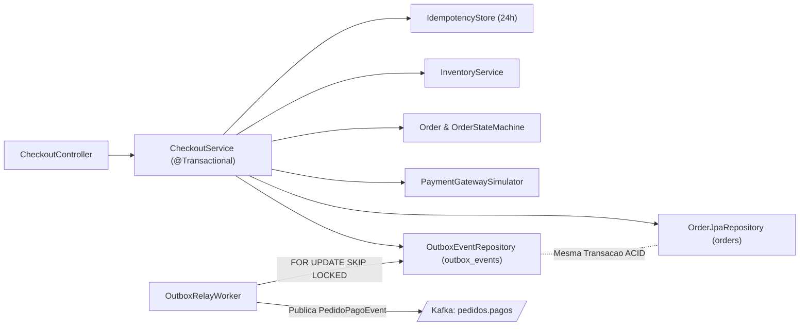

# 01 — Arquitetura C4

> [!abstract] Resumo Arquitetural
> Documentação arquitetural da plataforma [[00 - Visao Geral e Indice (MOC)|BolsoPass]] seguindo o [Modelo C4 (Context, Containers, Components)](https://c4model.com/) de Simon Brown. Esta especificação conecta os requisitos de negócio e atributos de qualidade definidos em [[04 - Requisitos Nao-Funcionais (RNFs)]] aos componentes implementados em código no Pacote 3 (`src/main/java/com/bolsopass/`).

---

## 1. Nivel 1 — Diagrama de Contexto

### Personas (Atores Humanos)

| Persona | Papel | Interação Principal |
| :--- | :--- | :--- |
| **Cliente / Comprador (Gabriel)** | Usuário final que compra ingressos | Navega catálogo, reserva assentos com TTL de 10 minutos, faz checkout com `Idempotency-Key` e baixa ingresso em PDF |
| **Organizadora de Evento (Beatriz)** | Produtora que cadastra megaeventos | Cria eventos, define lotes com validação de capacidade, mapeia assentos e consulta telemetria em tempo real |
| **Operador de Portaria (Marcos)** | Fiscal na catraca do estádio | Opera scanner de QR Code, valida assinatura ECDSA P-256 em $\le 300\text{ ms}$ (online e offline) e bloqueia dupla entrada |
| **Engenheira SRE / Admin (Ana)** | Equipe de plataforma BolsoPass | Audita credenciais, monitora SLOs, gerencia organizadores e acompanha saúde das filas Kafka |

### Sistemas Externos

| Sistema | Propósito | Protocolo |
| :--- | :--- | :--- |
| **Gateway de Pagamento** (`PaymentGatewaySimulator`) | Autorização e captura de cartão / PIX com simulação de falhas | HTTPS REST |
| **Provedor de E-mail** (SMTP) | Envio de comprovantes e ingresso digital em PDF | SMTP / TLS |
| **Provedor de SMS** (simulado) | Notificação multicanal de confirmação | HTTPS REST |
| **Keycloak / IAM Provedor** | Autenticação OIDC e emissão de tokens JWT RS256 | OIDC / OAuth 2.1 / JWKS |

### Diagrama de Contexto (Nível 1)

---

## 2. Nivel 2 — Diagrama de Conteineres

Cada contexto delimitado é projetado como uma unidade autônoma de execução, comunicando-se de forma assíncrona via [Apache Kafka](https://kafka.apache.org/) para eliminar acoplamento temporal durante picos de rajada (*flash crowd*).

### Contêineres de Aplicação

| Contêiner / Módulo | Tecnologia | Responsabilidade | Porta Padrão |
| :--- | :--- | :--- | :---: |
| **web-spa** | React 18 / HTML5 / CSS3 / JS | Interface SPA reativa (protótipo navegável em `mockups-high-res/index.html`) | 3000 |
| **gateway-bff** | Spring Cloud Gateway / Web | Roteamento de borda, propagação de `Idempotency-Key` e rate limiting | 8080 |
| **iam-service** (`com.bolsopass.iam`) | Spring Boot 3.3 (Java 21) | Emissão e validação de JWT RS256, RBAC, rotação de Refresh Token e auditoria | 8081 |
| **catalog-service** (`com.bolsopass.catalog`) | Spring Boot 3.3 (Java 21) | Eventos, locais e lotes com validação estrita de capacidade | 8082 |
| **inventory-service** (`com.bolsopass.inventory`) | Spring Boot 3.3 (Java 21) | Alocação atômica de assentos (*Zero Overselling*), TTL de 600s e devolução automática | 8083 |
| **orders-service** (`com.bolsopass.orders`) | Spring Boot 3.3 (Java 21) | Checkout, FSM do Pedido, `IdempotencyStore` (24h) e Transactional Outbox | 8084 |
| **ticketing-service** (`com.bolsopass.ticketing`) | Spring Boot 3.3 (Java 21) | Consumo idempotente (`processed_messages`), PDF (OpenPDF) e QR Code ECDSA P-256 | 8085 |
| **notification-service** | Spring Boot 3.3 (Java 21) | Push reativo em canal WebSocket (`/ws/orders/{orderId}`), e-mail e SMS | 8086 |
| **telemetry-service** (`com.bolsopass.telemetry`) | Spring Boot 3.3 (Java 21) | Agregação atômica de métricas de funil, vazão e auditoria de sobre-venda | 8087 |

### Contêineres de Infraestrutura

| Contêiner | Imagem Docker | Função na Arquitetura |
| :--- | :--- | :--- |
| **postgres** | `postgres:16-alpine` / `postgres:15-alpine` | Persistência relacional ACID (`orders`, `outbox_events`, `processed_messages`) |
| **redis** | `redis:7-alpine` | Locks distribuídos de reserva, famílias de Refresh Token e cache de catálogo |
| **kafka** | `confluentinc/cp-kafka:7.6` (KRaft) | Broker de eventos de domínio (`pedidos.pagos`, `reservas.expiradas`) |
| **keycloak** | `quay.io/keycloak/keycloak:25` | Provedor de identidade OIDC federado |
| **akhq** | `tchiotludo/akhq:latest` | Interface web para inspeção de tópicos e grupos consumidores do Kafka |
| **prometheus & grafana** | `prom/prometheus` & `grafana/grafana` | Coleta de métricas Actuator/Micrometer e painéis operacionais |

### Diagrama de Contêineres (Nível 2)

---

## 3. Nivel 3 — Diagrama de Componentes e Mapeamento para o Codigo (Pacote 3)

### 3.1 Módulo de Pedidos e Checkout (`com.bolsopass.orders`)

| Componente C4 | Classe Implementada (`src/main/java/com/bolsopass/orders/`) | Responsabilidade |
| :--- | :--- | :--- |
| **CheckoutController** | `api.CheckoutController` | Endpoint REST `POST /api/v1/checkout` (e `/checkout`) exigindo cabeçalho `Idempotency-Key` |
| **IdempotencyStore** | `domain.IdempotencyStore` | Deduplicação em janela de 24 horas com verificação de hash de payload e detecção de chamadas concorrentes (`PROCESSING` $\to$ `HTTP 409`) |
| **CheckoutService** | `service.CheckoutService` | Caso de uso transacional (`@Transactional`): valida reserva no inventário, aciona gateway, transiciona FSM e persiste `OrderEntity` + `OutboxEventEntity` em **1 transação ACID** |
| **OrderStateMachine & Order** | `domain.OrderStateMachine`, `domain.Order` | FSM formal: `CRIADO` $\to$ `RESERVADO` $\to$ `AGUARDANDO_PAGAMENTO` $\to$ `PAGO` $\mid$ `RECUSADO` $\mid$ `EXPIRADO` $\mid$ `CANCELADO` |
| **OrderJpaRepository** | `infrastructure.OrderJpaRepository` | Persistência JPA na tabela `orders` (`OrderEntity`) |
| **OutboxEventRepository** | `infrastructure.OutboxEventRepository` | Persistência JPA na tabela `outbox_events` (`OutboxEventEntity`) com query nativa `FOR UPDATE SKIP LOCKED` |
| **OutboxRelayWorker** | `service.OutboxRelayWorker` | Worker desacoplado que lê lote `PENDING`, publica no tópico `pedidos.pagos` do Kafka e marca `PUBLISHED` após ACK |
| **PaymentGatewaySimulator** | `service.PaymentGatewaySimulator` | Simulador financeiro com suporte a aprovação, recusa (`INSUFFICIENT_FUNDS`) e auditoria de número de cobranças |

### 3.2 Módulo de Inventário e Concorrência (`com.bolsopass.inventory`)

| Componente C4 | Classe Implementada (`src/main/java/com/bolsopass/inventory/`) | Responsabilidade |
| :--- | :--- | :--- |
| **ReservationController** | `api.ReservationController` | Endpoint `POST /api/v1/reservations` (e `/reservations`) conforme contrato OpenAPI 3.0 |
| **InventoryService** | `service.InventoryService` | Orquestração de inventário por evento, alocação e confirmação de reservas |
| **SeatInventory** | `domain.SeatInventory` | Coordenador de domínio thread-safe que garante *Zero Overselling*, invariante de conservação de estoque e expiração em lote |
| **Seat & Reservation** | `domain.Seat`, `domain.Reservation` | Agregados com lock atômico por assento, TTL estrito de $600\text{ s}$ (10 minutos) e emissão de `ReservaExpiradaEvent` |

### 3.3 Módulo de Emissão de Ingressos e Portaria (`com.bolsopass.ticketing`)

| Componente C4 | Classe Implementada (`src/main/java/com/bolsopass/ticketing/`) | Responsabilidade |
| :--- | :--- | :--- |
| **TicketingService** | `service.TicketingService` | Consumidor Kafka (`@KafkaListener` em `pedidos.pagos`), geração de PDF (OpenPDF + ZXing) e push WebSocket (`/ws/orders/{orderId}`) |
| **ProcessedMessageRepository** | `infrastructure.ProcessedMessageRepository` | Deduplicação mandatória via tabela `processed_messages(message_id, consumer_group, processed_at)` |
| **TicketCryptoSigner** | `domain.TicketCryptoSigner` | Assinatura digital assimétrica ECDSA P-256 (`secp256r1` / `SHA256withECDSA`) e verificação 100% offline via chave pública |
| **DigitalTicket** | `domain.DigitalTicket` | Agregado do bilhete digital com prevenção de dupla entrada na catraca (`AUTORIZADO` $\to$ `DUPLICATA` / `INVALIDO`) |

### 3.4 Módulo de Identidade e Governança (`com.bolsopass.iam`)

| Componente C4 | Classe Implementada (`src/main/java/com/bolsopass/iam/`) | Responsabilidade |
| :--- | :--- | :--- |
| **AuthController** | `api.AuthController` | Endpoints `/api/v1/auth/login`, `/api/v1/auth/refresh` e `/api/v1/auth/logout` |
| **IamService** | `service.IamService` | Geração e validação de JWT RS256 (TTL 900s), gestão de famílias de Refresh Tokens e trilha de auditoria |
| **UserAccount & RefreshTokenFamily** | `domain.UserAccount`, `domain.RefreshTokenFamily` | Regras RBAC (`Role`), bloqueio por *rate limiting* após 5 falhas (HTTP 429) e invalidação de família por replay de token |

### 3.5 Módulo de Telemetria (`com.bolsopass.telemetry`)

| Componente C4 | Classe Implementada (`src/main/java/com/bolsopass/telemetry/`) | Responsabilidade |
| :--- | :--- | :--- |
| **TelemetrySnapshot** | `domain.TelemetrySnapshot` | Contadores atômicos de vazão, conversão do funil de checkout, receita acumulada e auditoria de zero sobre-venda |

---

## 4. Padroes Arquiteturais Adotados e Verificados

| Padrão | Onde é Aplicado | Problema Resolvido e Verificação no Pacote 3 |
| :--- | :--- | :--- |
| **Transactional Outbox** | `CheckoutService` + `OutboxRelayWorker` | Elimina o *Dual-Write Dilemma* entre PostgreSQL e Kafka (`TransactionalOutboxIntegrationTest`). |
| **Idempotency-Key (24h)** | `CheckoutController` + `IdempotencyStore` | Garante *effectively-once* no checkout HTTP, impedindo cobrança duplicada (`OrderStateMachineTest`). |
| **Processed Messages Table** | `TicketingService` + `ProcessedMessageEntity` | Absorve reentregas *At-Least-Once* do Kafka sem duplicar ingressos PDF (`TransactionalOutboxIntegrationTest`). |
| **Fine-Grained Atomic Seat Lock** | `SeatInventory` + `Seat` | Garante $0,00\%$ de sobre-venda sob rajada concorrente (`SeatInventoryTest` com 200 threads). |
| **Refresh Token Rotation & Replay Detection** | `IamService` + `RefreshTokenFamily` | Contém sequestro de sessão revogando toda a família ao detectar reuso (`DomainModulesUnitTest`). |
| **Offline Asymmetric QR Verification** | `TicketCryptoSigner` + `DigitalTicket` | Permite validação na catraca sem internet em $< 5\text{ ms}$ via ECDSA P-256 (`DomainModulesUnitTest`). |
