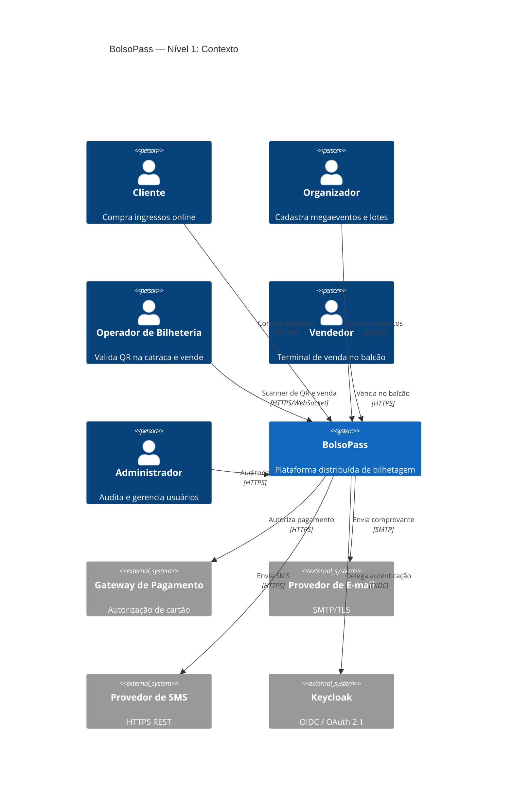
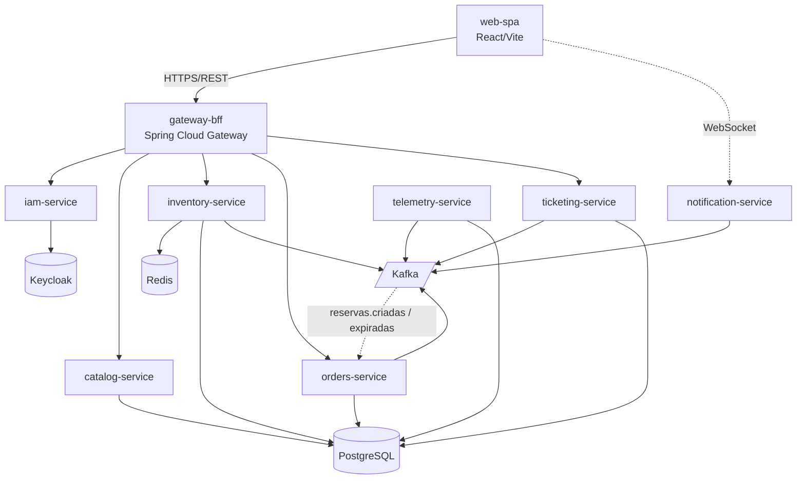
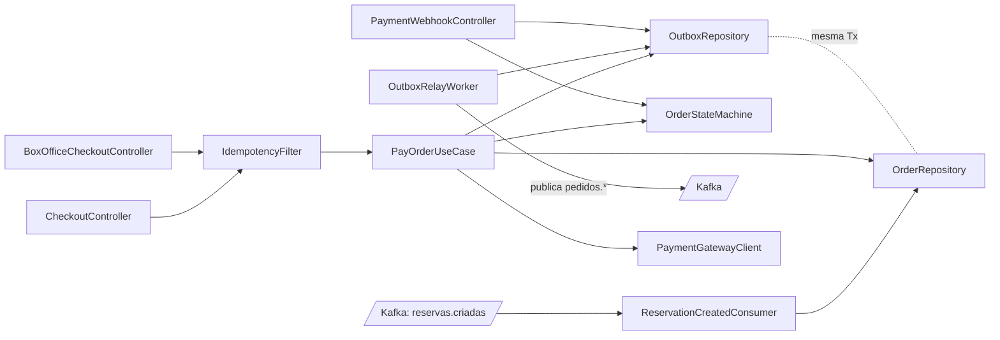

# 01 — Arquitetura C4

> Documentação arquitetural do BolsoPass seguindo o modelo **C4 (Context, Containers, Components)** de Simon Brown.

---

## Nível 1 — Diagrama de Contexto

### Personas (atores humanos)

| Persona | Papel | Interação principal |
|---|---|---|
| **Cliente / Comprador** | Usuário final que compra ingressos | Navega catálogo, reserva assentos, faz checkout, baixa ingresso em PDF |
| **Organizador de Evento** | Produtor que cadastra megaeventos | Cria eventos, define lotes, mapeia assentos, consulta telemetria |
| **Operador de Bilheteria (portaria)** | Pessoa física na catraca do evento | Opera scanner de QR no celular, autoriza/nega entrada, trabalha online e offline; também vende no balcão |
| **Vendedor (terminal de venda)** | Atendente do balcão da bilheteria | Só vende: busca o cliente pelo CPF, escolhe lugares vagos e cobra no crédito, PIX ou dinheiro (maquininha) |
| **Administrador da Plataforma** | Equipe BolsoPass | Audita credenciais, cadastra usuários e promove contas (Admin, Bilheteria, Venda), monitora SLOs |

> **Um perfil por conta.** O cadastro público cria sempre um Cliente; os perfis de equipe são dados
> pela administração. Bilheteria e Venda entram com **matrícula + PIN**.

### Sistemas externos

| Sistema | Propósito | Protocolo |
|---|---|---|
| **Gateway de Pagamento** (simulado) | Autorização de cartão e PIX (dinheiro só no balcão) | HTTPS REST (webhook de callback) |
| **Provedor de E-mail** (SMTP) | Envio de comprovantes e ingresso em PDF | SMTP/TLS |
| **Provedor de SMS** (simulado) | Notificação multicanal de confirmação | HTTPS REST |
| **Keycloak** | OIDC — autenticação federada | OIDC / OAuth 2.1 |

### Diagrama (textual — mermaid)

---

## Nível 2 — Diagrama de Contêineres

Cada microsserviço é um **contêiner Docker independente** com seu próprio ciclo de deploy.

### Contêineres de aplicação

| Contêiner | Tecnologia | Responsabilidade | Porta |
|---|---|---|---|
| **web-spa** | React 18 + Vite + TS (nginx: HTTP 3000, HTTPS 3443) | SPA do cliente, administração e app da bilheteria (celular) | 3000 / 3443 |
| **iam-service** | Spring Boot 3.5 | Delegação para Keycloak, cadastro público (sempre Cliente), gestão de usuários e perfis (um por conta), matrícula + PIN da bilheteria, código de ativação de contas do balcão, auditoria | 8081 |
| **catalog-service** | Spring Boot 3.5 | Eventos, lotes, mapas de assentos | 8082 |
| **inventory-service** | Spring Boot 3.5 | Alocação/devolução atômica de assentos, locks Redis, sala de espera virtual, reservas (inclusive as do balcão) | 8083 |
| **orders-service** | Spring Boot 3.5 | Checkout, FSM do pedido, Idempotency-Key, Transactional Outbox, pagamento da venda no balcão (crédito, PIX, dinheiro) | 8084 |
| **ticketing-service** | Spring Boot 3.5 | Geração de PDF + QR assinado (ECDSA P-256), carteira por CPF do titular, portaria (base offline e sincronização de leituras) | 8085 |
| **notification-service** | Spring Boot 3.5 | Disparo multicanal (e-mail, SMS, WebSocket) | 8086 |
| **telemetry-service** | Spring Boot 3.5 | Ingestão e agregação de eventos de negócio | 8087 |
| **gateway-bff** | Spring Cloud Gateway | API Gateway / BFF (roteamento + rate limit) | 8080 |

### Contêineres de infraestrutura

| Contêiner | Imagem | Função |
|---|---|---|
| **postgres** | postgres:16-alpine | Banco relacional (schemas isolados por serviço) |
| **redis** | redis:7-alpine | Locks distribuídos + cache de catálogo |
| **kafka** | apache/kafka:3.8.0 (KRaft) | Broker de eventos |
| **keycloak** | quay.io/keycloak/keycloak:25 | Provedor de identidade |
| **akhq** | tchiotludo/akhq:0.25.1 | UI de inspeção do Kafka (porta 8089) |
| **mailpit** | axllent/mailpit | Caixa de e-mail falsa para os comprovantes em desenvolvimento (porta 8025) |
| **prometheus** | prom/prometheus | Scraping de métricas |
| **grafana** | grafana/grafana | Dashboards |

### Diagrama (mermaid)

### Decisões de contêinerização

- **Database per service** — cada serviço tem seu *schema* isolado no mesmo cluster PostgreSQL (economia operacional sem perder isolamento lógico).
- **Keycloak** usa `postgres` compartilhado em schema próprio (`keycloak`).
- **Kafka em modo KRaft** elimina a dependência de Zookeeper, simplificando o `docker-compose`.
- **WebSocket** só no `notification-service` para empurrar atualizações de status de reserva e assento à SPA.

---

## Nível 3 — Diagrama de Componentes (por serviço)

### 3.1 orders-service (o mais crítico)

| Componente | Responsabilidade |
|---|---|
| **ReservationCreatedConsumer** | Consome `reservas.criadas` e cria o pedido em `RESERVADO` com o id que já nasce na reserva (idempotente via `processed_messages`) |
| **ReservationExpiredConsumer** | Consome `reservas.expiradas` e leva o pedido a `EXPIRADO` |
| **CheckoutController** | `POST /checkout` com validação de `Idempotency-Key` (cartão ou PIX; dinheiro é recusado online) |
| **BoxOfficeCheckoutController** | Pagamento da venda no balcão (`/operator/box-office/checkout`): crédito, PIX ou **dinheiro**, só para Bilheteria e Venda |
| **IdempotencyFilter** | Interceptador que consulta tabela `idempotency_keys` antes do handler |
| **PayOrderUseCase** | Autoriza no gateway, aplica a FSM e grava pedido + `pedidos.pagos` no outbox — **1 transação ACID** |
| **OrderStateMachine** | FSM: `CRIADO → RESERVADO → AGUARDANDO_PAGAMENTO → PAGO ∣ RECUSADO ∣ EXPIRADO ∣ CANCELADO` |
| **OrderRepository** | JPA repository (`orders`, `order_items`) |
| **OutboxRepository** | JPA repository (`outbox_messages`) |
| **OutboxRelayWorker** | `@Scheduled` que lê outbox (`FOR UPDATE SKIP LOCKED`) e publica no Kafka com `acks=all`; só marca enviado depois do ACK |
| **PaymentWebhookController** | Recebe callback do gateway, atualiza FSM, grava outbox |
| **PaymentGatewayClient** | Cliente do gateway simulado (cartão final `0000` = recusa) |

> O orders-service **não chama o inventory**: ele **consome as reservas** (como pede o enunciado) e
> a expiração também chega por evento. Assim, se o orders cair, as reservas continuam e os pedidos
> são criados quando ele voltar.

### 3.2 inventory-service

| Componente | Responsabilidade |
|---|---|
| **ReservationController** | `POST /reservations` e `DELETE /reservations/{id}`; o id do pedido já nasce aqui e vai no evento |
| **BoxOfficeReservationController** | Reserva em nome do cliente no balcão: sem sala de espera e sem o limite de uma reserva online aberta |
| **VirtualQueue** | Sala de espera virtual dos eventos de grande procura |
| **AtomicSeatAllocator** | Lock Redis (SETNX com TTL de 10min) + `SELECT … FOR UPDATE` no PostgreSQL |
| **SeatRepository** | JPA repository (`seats`, `seat_locks`) |
| **ReservationExpiryWorker** | Job que varre reservas vencidas e publica `reservas.expiradas` |
| **ReservationEventPublisher** | Produz `reservas.criadas` e `reservas.liberadas` via outbox |
| **PaymentConfirmedConsumer** | Consome `pedidos.pagos` (assento → VENDIDO) e `pedidos.cancelados` (assento volta à venda) |

### 3.3 ticketing-service

| Componente | Responsabilidade |
|---|---|
| **PaymentConfirmedConsumer** | Consome `pedidos.pagos` com idempotência (`processed_messages`) e emite um ingresso por titular |
| **PdfGenerator** | Renderiza PDF (iText 7) com dados do pedido |
| **QrSigner** | Assina payload do ingresso com ECDSA P-256; QR dinâmico que muda a cada 15 s |
| **WalletQuery** | Carteira do cliente: ingressos que comprou **e** ingressos em que o CPF dele é o titular (venda no balcão ou acompanhante) |
| **GateController** | Portaria: chave pública + base de ingressos do evento para validar **offline**; recebe as leituras e publica `ingressos.validados` |
| **TicketRepository** | JPA repository (`tickets`, `ticket_scans`) |
| **TicketStorageClient** | Persiste PDF (filesystem local ou S3) |

### 3.4 notification-service

| Componente | Responsabilidade |
|---|---|
| **TicketIssuedConsumer** | Consome `ingressos.emitidos` |
| **EmailSender** | SMTP via Spring Mail |
| **SmsSender** | Cliente HTTP para gateway simulado |
| **WebSocketBroadcaster** | STOMP/WebSocket pushando ao canal da sessão |

### 3.5 iam-service

| Componente | Responsabilidade |
|---|---|
| **JwtAuthFilter** | Valida assinatura JWS contra JWKS do Keycloak |
| **RbacAuthorizationFilter** | Checa roles (CLIENTE / ORGANIZADOR / ADMIN / OPERADOR / VENDEDOR) |
| **RegistrationController** | Cadastro público: **sempre Cliente**; CPF de conta criada no balcão só é assumido com o **código de ativação** (6 dígitos, 24 h, só o hash no banco) |
| **UserAdminController** | Página Usuários (só Admin): lista com filtros, cadastro com perfil, promover/rebaixar (um perfil por conta), matrícula + PIN gerados uma vez |
| **OperatorLoginController** | Login da bilheteria por matrícula + PIN (PIN separado da senha) |
| **UserProfileController** | Perfil estendido (CPF, telefone) |
| **AuditLogger** | Grava auditoria em `audit_events` (contas criadas, perfis alterados, códigos gerados, consultas a dados de compradores) |

### 3.6 telemetry-service

| Componente | Responsabilidade |
|---|---|
| **DomainEventConsumer** | Consome todos os tópicos de domínio |
| **MetricsAggregator** | Agrega por janela (minuto/hora) |
| **DashboardController** | Endpoints REST para o painel do organizador |

---

## Padrões arquiteturais adotados

| Padrão | Onde | Por quê |
|---|---|---|
| **Transactional Outbox** | `orders-service`, `inventory-service` | Elimina Dual-Write Dilemma entre PostgreSQL e Kafka |
| **Idempotency Key** | `gateway-bff` + `orders-service` | Garantia de exactly-once perceived no checkout |
| **Processed Messages Table** | Todos os consumers | Deduplicação na recepção (at-least-once → effectively-once) |
| **CQRS leve** | `catalog-service` | Leitura via Redis cache, escrita via PostgreSQL |
| **BFF (Backend-for-Frontend)** | `gateway-bff` | Agrega chamadas e expõe DTOs otimizados para o SPA |
| **Database per Service** | Todos | Isolamento lógico de schemas |
| **Saga coreografada** | Reserva → Pedido → Pagamento → Emissão → Notificação | Sem orquestrador central; eventos Kafka costuram o fluxo |
| **Um perfil por conta** | `iam-service` | Promover troca o perfil; quem vira equipe não compra como cliente |
