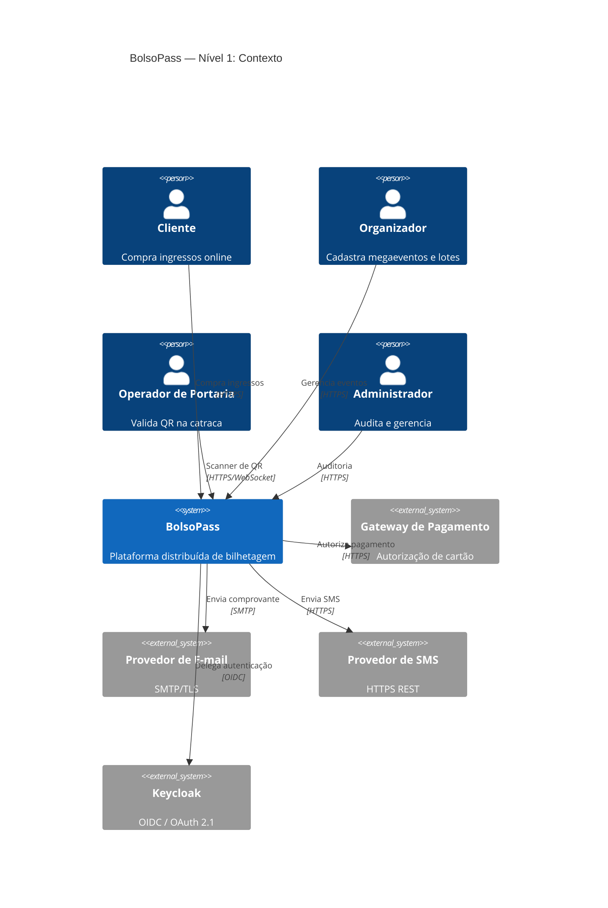
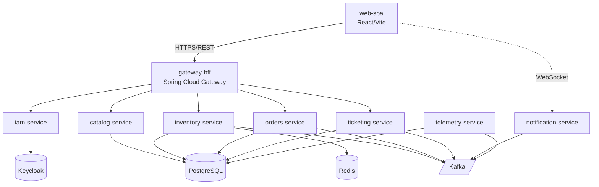
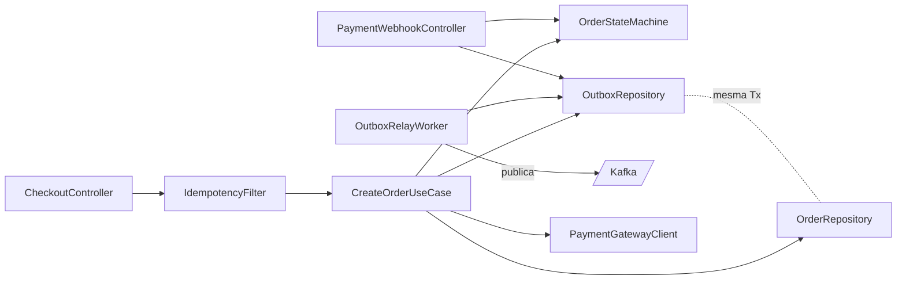

# 01 — Arquitetura C4

> Documentação arquitetural do BolsoPass seguindo o modelo **C4 (Context, Containers, Components)** de Simon Brown.

---

## Nível 1 — Diagrama de Contexto

### Personas (atores humanos)

| Persona | Papel | Interação principal |
|---|---|---|
| **Cliente / Comprador** | Usuário final que compra ingressos | Navega catálogo, reserva assentos, faz checkout, baixa ingresso em PDF |
| **Organizador de Evento** | Produtor que cadastra megaeventos | Cria eventos, define lotes, mapeia assentos, consulta telemetria |
| **Operador de Portaria** | Pessoa física na catraca do evento | Opera scanner de QR, autoriza/nega entrada, trabalha online e offline |
| **Administrador da Plataforma** | Equipe BolsoPass | Audita credenciais, gerencia organizadores, monitora SLOs |

### Sistemas externos

| Sistema | Propósito | Protocolo |
|---|---|---|
| **Gateway de Pagamento** (simulado) | Autorização e captura de cartão | HTTPS REST (webhook de callback) |
| **Provedor de E-mail** (SMTP) | Envio de comprovantes e ingresso em PDF | SMTP/TLS |
| **Provedor de SMS** (simulado) | Notificação multicanal de confirmação | HTTPS REST |
| **Keycloak** | OIDC — autenticação federada | OIDC / OAuth 2.1 |

### Diagrama (textual — mermaid)

---

## Nível 2 — Diagrama de Contêineres

Cada microsserviço é um **contêiner Docker independente** com seu próprio ciclo de deploy.

### Contêineres de aplicação

| Contêiner | Tecnologia | Responsabilidade | Porta |
|---|---|---|---|
| **web-spa** | React 18 + Vite + TS | Interface SPA do cliente/organizador | 3000 |
| **iam-service** | Spring Boot 3.3 | Delegação para Keycloak, perfis e auditoria | 8081 |
| **catalog-service** | Spring Boot 3.3 | Eventos, lotes, mapas de assentos | 8082 |
| **inventory-service** | Spring Boot 3.3 | Alocação/devolução atômica de assentos, locks Redis | 8083 |
| **orders-service** | Spring Boot 3.3 | Checkout, FSM do pedido, Transactional Outbox | 8084 |
| **ticketing-service** | Spring Boot 3.3 | Geração de PDF + QR assinado (ECDSA P-256) | 8085 |
| **notification-service** | Spring Boot 3.3 | Disparo multicanal (e-mail, SMS, WebSocket) | 8086 |
| **telemetry-service** | Spring Boot 3.3 | Ingestão e agregação de eventos de negócio | 8087 |
| **gateway-bff** | Spring Cloud Gateway | API Gateway / BFF (roteamento + rate limit) | 8080 |

### Contêineres de infraestrutura

| Contêiner | Imagem | Função |
|---|---|---|
| **postgres** | postgres:16-alpine | Banco relacional (schemas isolados por serviço) |
| **redis** | redis:7-alpine | Locks distribuídos + cache de catálogo |
| **kafka** | confluentinc/cp-kafka:7.6 (KRaft) | Broker de eventos |
| **keycloak** | quay.io/keycloak/keycloak:25 | Provedor de identidade |
| **akhq** | tchiotludo/akhq:latest | UI de inspeção do Kafka |
| **prometheus** | prom/prometheus | Scraping de métricas |
| **grafana** | grafana/grafana | Dashboards |

### Diagrama (mermaid)

### Decisões de contêinerização

- **Database per service** — cada serviço tem seu *schema* isolado no mesmo cluster PostgreSQL (economia operacional sem perder isolamento lógico).
- **Keycloak** usa `postgres` compartilhado em schema próprio (`keycloak`).
- **Kafka em modo KRaft** elimina a dependência de Zookeeper, simplificando o `docker-compose`.
- **WebSocket** só no `notification-service` para empurrar atualizações de status de reserva e assento à SPA.

---

## Nível 3 — Diagrama de Componentes (por serviço)

### 3.1 orders-service (o mais crítico)

| Componente | Responsabilidade |
|---|---|
| **CheckoutController** | Endpoint REST `POST /orders` com validação de `Idempotency-Key` |
| **IdempotencyFilter** | Interceptador que consulta tabela `idempotency_keys` antes do handler |
| **CreateOrderUseCase** | Orquestra: valida reserva no inventory, cria pedido, grava outbox — **1 transação ACID** |
| **OrderStateMachine** | FSM: `CRIADO → RESERVADO → AGUARDANDO_PAGAMENTO → PAGO ∣ EXPIRADO ∣ CANCELADO` |
| **OrderRepository** | JPA repository (`orders`, `order_items`) |
| **OutboxRepository** | JPA repository (`outbox_messages`) |
| **OutboxRelayWorker** | `@Scheduled` que lê outbox e publica no Kafka (at-least-once + marca enviado) |
| **PaymentWebhookController** | Recebe callback do gateway, atualiza FSM, grava outbox |
| **PaymentGatewayClient** | Feign client para o gateway simulado |

### 3.2 inventory-service

| Componente | Responsabilidade |
|---|---|
| **ReservationController** | `POST /reservations` e `DELETE /reservations/{id}` |
| **AtomicSeatAllocator** | Lock Redis (SETNX com TTL de 10min) + constraint única no PostgreSQL |
| **SeatRepository** | JPA repository (`seats`, `seat_locks`) |
| **ReservationExpiryWorker** | Job que varre reservas vencidas e publica `reservation.expired` |
| **ReservationEventPublisher** | Produz `reservation.created` e `reservation.released` via outbox |

### 3.3 ticketing-service

| Componente | Responsabilidade |
|---|---|
| **PaymentConfirmedConsumer** | Consome `payment.confirmed` com idempotência (`processed_messages`) |
| **PdfGenerator** | Renderiza PDF (iText 7) com dados do pedido |
| **QrSigner** | Assina payload do ingresso com ECDSA P-256 |
| **TicketRepository** | JPA repository (`tickets`) |
| **TicketStorageClient** | Persiste PDF (filesystem local ou S3) |

### 3.4 notification-service

| Componente | Responsabilidade |
|---|---|
| **TicketIssuedConsumer** | Consome `ticket.issued` |
| **EmailSender** | SMTP via Spring Mail |
| **SmsSender** | Cliente HTTP para gateway simulado |
| **WebSocketBroadcaster** | STOMP/WebSocket pushando ao canal da sessão |

### 3.5 iam-service

| Componente | Responsabilidade |
|---|---|
| **JwtAuthFilter** | Valida assinatura JWS contra JWKS do Keycloak |
| **RbacAuthorizationFilter** | Checa roles (CLIENTE / ORGANIZADOR / OPERADOR / ADMIN) |
| **UserProfileController** | Perfil estendido (CPF, telefone, endereço) |
| **AuditLogger** | Grava auditoria em `audit_events` |

### 3.6 telemetry-service

| Componente | Responsabilidade |
|---|---|
| **DomainEventConsumer** | Consome todos os tópicos de domínio |
| **MetricsAggregator** | Agrega por janela (minuto/hora) |
| **DashboardController** | Endpoints REST para o painel do organizador |

---

## Padrões arquiteturais adotados

| Padrão | Onde | Por quê |
|---|---|---|
| **Transactional Outbox** | `orders-service`, `inventory-service` | Elimina Dual-Write Dilemma entre PostgreSQL e Kafka |
| **Idempotency Key** | `gateway-bff` + `orders-service` | Garantia de exactly-once perceived no checkout |
| **Processed Messages Table** | Todos os consumers | Deduplicação na recepção (at-least-once → effectively-once) |
| **CQRS leve** | `catalog-service` | Leitura via Redis cache, escrita via PostgreSQL |
| **BFF (Backend-for-Frontend)** | `gateway-bff` | Agrega chamadas e expõe DTOs otimizados para o SPA |
| **Database per Service** | Todos | Isolamento lógico de schemas |
| **Saga coreografada** | Checkout → Pagamento → Emissão → Notificação | Sem orquestrador central; eventos Kafka costuram o fluxo |
