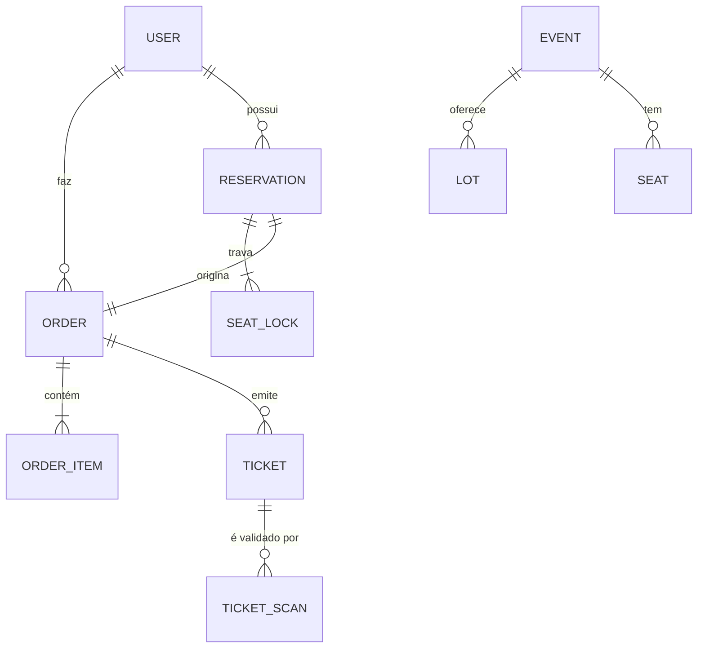

# 02 — Modelo de Dados Conceitual

> Modelo conceitual por bounded context (Database per Service). Cada seção descreve as entidades, atributos essenciais, cardinalidades e invariantes de domínio.

---

## 1. Convenções

- **PK** = chave primária (UUID v7 por padrão).
- **FK** = chave estrangeira *lógica* (entre serviços não há FK física — só por evento).
- Timestamps `created_at` e `updated_at` implícitos em todas as entidades.
- Soft-delete via `deleted_at` apenas onde há necessidade de auditoria.

---

## 2. Schema `iam` (iam-service)

### Entidades

| Entidade | Atributos principais | Observações |
|---|---|---|
| **UserProfile** | `id` (PK), `keycloak_sub` (UNIQUE), `cpf`, `nome`, `telefone`, `email` | Keycloak é a fonte de verdade da identidade; aqui mora o perfil estendido |
| **OrganizerAccount** | `id` (PK), `user_id` (FK UserProfile), `razao_social`, `cnpj`, `status` | Status: `PENDENTE_VALIDACAO`, `ATIVO`, `SUSPENSO` |
| **AuditEvent** | `id` (PK), `user_id`, `action`, `resource`, `payload` (JSONB), `occurred_at` | Append-only; particionado por mês |

### Relações

- `UserProfile 1..1 — 0..1 OrganizerAccount` (um usuário pode se tornar organizador).

---

## 3. Schema `catalog` (catalog-service)

### Entidades

| Entidade | Atributos principais |
|---|---|
| **Event** | `id` (PK), `organizer_id` (FK lógica), `title`, `description`, `starts_at`, `ends_at`, `venue_id`, `status` |
| **Venue** | `id` (PK), `name`, `address`, `city`, `capacity_total` |
| **Section** | `id` (PK), `venue_id` (FK), `name` (ex: "Pista", "Camarote A"), `price_tier` |
| **SeatMap** | `id` (PK), `section_id` (FK), `row`, `number`, `coordinates` (JSONB) |
| **Lot** | `id` (PK), `event_id` (FK), `name` (ex: "1º Lote"), `price`, `starts_at`, `ends_at`, `quota` |

### Relações

- `Venue 1..n Section 1..n SeatMap`
- `Event n..1 Venue`
- `Event 1..n Lot`

### Invariantes

- `Lot.ends_at > Lot.starts_at`
- `sum(Lot.quota) <= Venue.capacity_total` por evento.

---

## 4. Schema `inventory` (inventory-service)

### Entidades

| Entidade | Atributos principais |
|---|---|
| **Seat** | `id` (PK), `event_id`, `section_id`, `row`, `number`, `status`, `version` (optimistic lock) |
| **SeatLock** | `id` (PK), `seat_id` (FK UNIQUE enquanto ativo), `user_id`, `expires_at`, `reservation_id` |
| **Reservation** | `id` (PK), `user_id`, `event_id`, `status`, `expires_at`, `created_at` |
| **ReservationItem** | `id` (PK), `reservation_id` (FK), `seat_id` |

### Status possíveis

- `Seat.status`: `DISPONIVEL`, `BLOQUEADO`, `VENDIDO`.
- `Reservation.status`: `ATIVA`, `CONFIRMADA`, `EXPIRADA`, `CANCELADA`.

### Invariantes

- **UNIQUE** sobre `(seat_id)` em `SeatLock` enquanto `expires_at > NOW()` — barreira final contra sobre-venda além do lock Redis.
- `Reservation.expires_at = created_at + INTERVAL '10 minutes'`.
- `Seat.status = 'VENDIDO'` só por consumo de evento `payment.confirmed`.

---

## 5. Schema `orders` (orders-service)

### Entidades

| Entidade | Atributos principais |
|---|---|
| **Order** | `id` (PK), `user_id`, `event_id`, `reservation_id`, `total_amount`, `status`, `state_updated_at` |
| **OrderItem** | `id` (PK), `order_id` (FK), `seat_id`, `lot_id`, `unit_price` |
| **IdempotencyKey** | `key` (PK), `user_id`, `request_hash`, `response_body` (JSONB), `created_at`, `expires_at` |
| **OutboxMessage** | `id` (PK), `aggregate_type`, `aggregate_id`, `topic`, `payload` (JSONB), `created_at`, `published_at` (nullable) |
| **ProcessedMessage** | `message_id` (PK), `consumer_group`, `processed_at` |

### FSM — `Order.status`

```
CRIADO ──▶ RESERVADO ──▶ AGUARDANDO_PAGAMENTO ──▶ PAGO
   │           │                   │                  
   └───────────┴───────────────────┴──▶ EXPIRADO / CANCELADO
```

### Invariantes

- `IdempotencyKey.expires_at = created_at + INTERVAL '24 hours'`.
- Toda transição de `Order.status` grava `OutboxMessage` **na mesma transação**.
- `OutboxMessage` nunca é deletada antes de `published_at IS NOT NULL + 7 dias` (auditoria).

---

## 6. Schema `ticketing` (ticketing-service)

### Entidades

| Entidade | Atributos principais |
|---|---|
| **Ticket** | `id` (PK), `order_id` (FK lógica), `seat_id`, `event_id`, `qr_payload`, `qr_signature`, `pdf_path`, `issued_at` |
| **TicketScan** | `id` (PK), `ticket_id` (FK), `operator_id`, `scanned_at`, `result` (`AUTORIZADO`/`DUPLICATA`/`INVALIDO`), `offline_sync` (bool) |
| **ProcessedMessage** | `message_id` (PK), `consumer_group`, `processed_at` |

### Invariantes

- `qr_signature` = ECDSA P-256 sobre `qr_payload` (hex-encoded).
- Primeiro `TicketScan` com `result = AUTORIZADO` bloqueia os seguintes (`DUPLICATA`).

---

## 7. Schema `telemetry` (telemetry-service)

### Entidades

| Entidade | Atributos principais |
|---|---|
| **DomainEventLog** | `id` (PK), `event_type`, `payload` (JSONB), `occurred_at` — particionado por dia |
| **SalesAggregate** | `event_id`, `bucket_minute`, `tickets_sold`, `revenue`, `conversion_rate` (PK composta) |
| **FlashCrowdMetric** | `event_id`, `bucket_second`, `requests_per_sec`, `rejected`, `avg_latency_ms` |

---

## 8. Visão integrada (relações entre contextos via eventos)



**Nota:** as linhas acima são **relações de domínio**, não FKs físicas entre bancos — a consistência entre contextos é mantida por eventos Kafka (ver [03 - Mensageria Kafka](03%20-%20Mensageria%20Kafka.md)).

---

## 9. Estratégia de migrations

- **Flyway** em cada microsserviço, scripts versionados (`V1__init.sql`, `V2__add_outbox.sql`, …).
- Cada serviço roda suas migrations no startup contra seu próprio schema.
- Breaking changes seguem o padrão **Expand/Contract** (adiciona coluna → backfill → remove coluna) em deploys separados.
