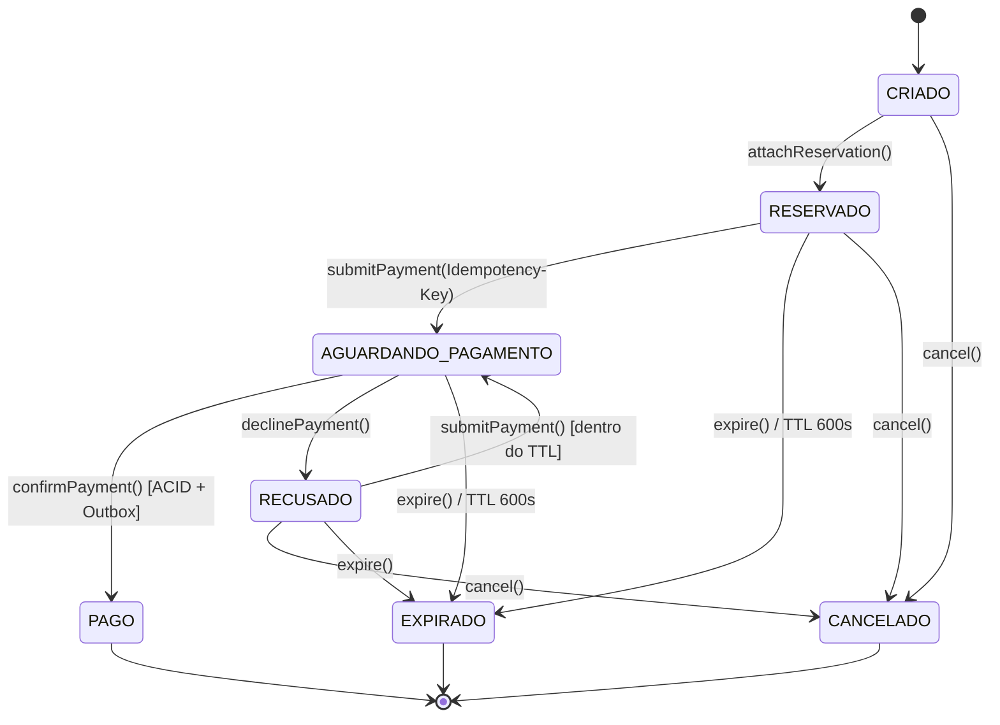
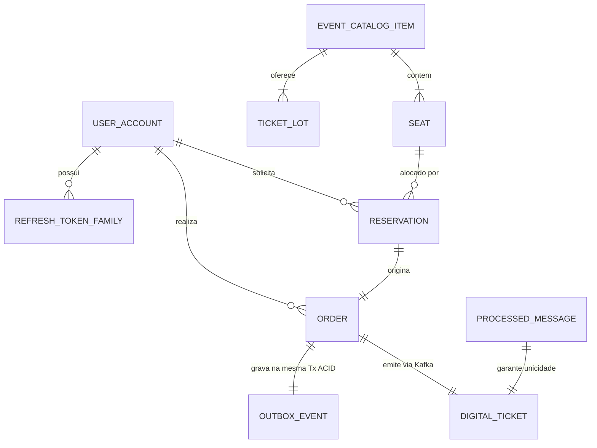

# 02 — Modelo de Dados Conceitual

> [!abstract] Resumo da Modelagem de Dados
> Modelo conceitual e relacional organizado por contexto delimitado (*Database per Service / Bounded Context*) da plataforma [[00 - Visao Geral e Indice (MOC)|BolsoPass]]. Cada seção descreve as entidades, atributos essenciais, cardinalidades, invariantes de domínio e sua materialização nas classes de domínio e entidades JPA implementadas no Pacote 3 (`src/main/java/com/bolsopass/`).

---

## 1. Convencoes Gerais

- **PK** = chave primária (`UUID` por padrão em todos os agregados).
- **FK lógica** = referências entre contextos delimitados distintos utilizam identificadores `UUID` propagados via eventos Kafka, sem acoplamento físico de chave estrangeira entre bancos de serviços independentes.
- **Timestamps UTC** = todos os instantes temporais (`created_at`, `updated_at`, `expires_at`, `paid_at`, `published_at`, `processed_at`) são representados em UTC (`java.time.Instant`).

---

## 2. Contexto `iam` (`com.bolsopass.iam`)

### Entidades e Agregados

| Entidade / Agregado | Classe no Pacote 3 | Atributos Principais | Invariantes e Regras |
| :--- | :--- | :--- | :--- |
| **UserAccount** | `iam.domain.UserAccount` | `id` (PK), `email` (UNIQUE), `cpf`, `fullName`, `passwordHash`, `roles` (`Set<Role>`), `consecutiveFailedAttempts`, `lockedUntil` | Bloqueio automático de 1 minuto após 5 tentativas falhas consecutivas (`AccountRateLimitedException` — HTTP 429) |
| **RefreshTokenFamily** | `iam.domain.RefreshTokenFamily` | `familyId` (PK), `userId`, `activeTokenValue`, `familyCompromised`, `tokensByValue` (`issuedAt`, `expiresAt`, `rotated`, `revoked`) | TTL de 7 dias; reapresentação de token já rotacionado revoga toda a família (`RefreshTokenReuseException` — HTTP 401) |
| **AuditEvent** | `iam.domain.AuditEvent` | `id` (PK), `userId`, `action`, `resource`, `details`, `occurredAt` | Registro *append-only* imutável para trilha de segurança (`RF-03`) |

---

## 3. Contexto `catalog` (`com.bolsopass.catalog`)

### Entidades e Agregados

| Entidade / Agregado | Classe no Pacote 3 | Atributos Principais |
| :--- | :--- | :--- |
| **EventCatalogItem** | `catalog.domain.EventCatalogItem` | `eventId` (PK), `organizerId`, `title`, `venueName`, `venueCapacityTotal`, `startsAt`, `endsAt`, `lots` (`List<TicketLot>`) |
| **TicketLot** | `catalog.domain.EventCatalogItem.TicketLot` | `lotId` (PK), `name`, `priceCents`, `quota`, `startsAt`, `endsAt` |

### Invariantes de Domínio (Verificadas em `DomainModulesUnitTest`)
- `TicketLot.endsAt > TicketLot.startsAt` e `EventCatalogItem.endsAt > EventCatalogItem.startsAt`.
- $\sum \text{TicketLot.quota} \le \text{EventCatalogItem.venueCapacityTotal}$ por evento.

---

## 4. Contexto `inventory` (`com.bolsopass.inventory`)

### Entidades e Agregados

| Entidade / Agregado | Classe no Pacote 3 | Atributos Principais |
| :--- | :--- | :--- |
| **Seat** | `inventory.domain.Seat` | `eventId`, `seatId` (ex.: `"A-12"`), `section`, `priceCents`, `status` (`SeatStatus`), `currentReservationId`, `reservedByUserId`, `reservedUntil`, `version` |
| **Reservation** | `inventory.domain.Reservation` | `reservationId` (PK), `eventId`, `seatId`, `userId`, `createdAt`, `expiresAt`, `ttlSeconds` (`600`), `status` (`ReservationStatus`) |
| **SeatInventory** | `inventory.domain.SeatInventory` | `eventId`, `seatsByCode`, `reservationsById`, `publishedExpirationEvents` (`List<ReservaExpiradaEvent>`) |

### Estados e Invariantes (Verificados em `SeatInventoryTest`)
- `SeatStatus`: `DISPONIVEL`, `RESERVADO_TEMPORARIO`, `VENDIDO`, `UTILIZADO`.
- `ReservationStatus`: `RESERVADO_TEMPORARIO`, `CONFIRMADA`, `EXPIRADO`, `CANCELADA`.
- **Exclusão Mútua Estrita:** Apenas uma reserva ativa pode existir para um dado `(eventId, seatId)` em qualquer instante.
- **TTL Estrito de 10 Minutos:** `Reservation.expiresAt = createdAt + 600 segundos`.
- **Conservação de Estoque:** $\text{disponíveis} + \text{reservados} + \text{vendidos} + \text{utilizados} = \text{capacidade total}$.

---

## 5. Contexto `orders` (`com.bolsopass.orders`)

### Entidades Relacionais JPA e Agregados de Domínio

| Entidade / Tabela | Classe no Pacote 3 | Colunas / Atributos Principais |
| :--- | :--- | :--- |
| **Order / `orders`** | `orders.domain.Order` `orders.infrastructure.OrderEntity` | `id` (PK), `client_id`, `event_id`, `reservation_id`, `seat_id`, `amount_cents`, `status` (`OrderStatus`), `idempotency_key`, `paid_at`, `created_at`, `updated_at` |
| **OutboxEvent / `outbox_events`** | `orders.infrastructure.OutboxEventEntity` | `id` (PK), `aggregate_type` (`"Order"`), `aggregate_id`, `topic` (`"pedidos.pagos"`), `event_type` (`"PedidoPagoEvent"`), `payload` (JSON), `status` (`"PENDING"` / `"PUBLISHED"`), `created_at`, `published_at` |
| **IdempotencyStore** | `orders.domain.IdempotencyStore` | `key` (PK), `requestFingerprint`, `state` (`PROCESSING` / `COMPLETED`), `cachedResponse`, `createdAt`, `expiresAt` (`+24h`) |

### Máquina de Estados Finitos (`Order.status`)

---

## 6. Contexto `ticketing` (`com.bolsopass.ticketing`)

### Entidades Relacionais JPA e Agregados de Domínio

| Entidade / Tabela | Classe no Pacote 3 | Colunas / Atributos Principais |
| :--- | :--- | :--- |
| **DigitalTicket** | `ticketing.domain.DigitalTicket` | `ticketId` (PK), `orderId`, `clientId`, `eventId`, `seatId`, `issuedAt`, `timestampHash` (SHA-256), `qrPayload`, `qrSignature` (ECDSA P-256 hex), `pdfContent` (`byte[]`), `scannedAtGate`, `firstScannedAt` |
| **ProcessedMessage / `processed_messages`** | `ticketing.infrastructure.ProcessedMessageEntity` | `message_id` (PK), `consumer_group` (`"ticketing-payment"`), `processed_at` |

### Invariantes (Verificadas em `DomainModulesUnitTest` e `TransactionalOutboxIntegrationTest`)
- `qrSignature` = assinatura ECDSA P-256 (`SHA256withECDSA`) sobre `qrPayload`.
- O primeiro check-in válido na catraca transiciona `scannedAtGate = true` e retorna `ScanResultStatus.AUTORIZADO`; leituras subsequentes do mesmo bilhete retornam `ScanResultStatus.DUPLICATA`.
- Mensagens Kafka cujo `message_id` já conste em `processed_messages` são descartadas como *no-op* idempotente.

---

## 7. Contexto `telemetry` (`com.bolsopass.telemetry`)

| Agregado | Classe no Pacote 3 | Atributos Principais |
| :--- | :--- | :--- |
| **TelemetrySnapshot** | `telemetry.domain.TelemetrySnapshot` | `totalRequests`, `reservationsCreated`, `reservationsRejectedConflict`, `reservationsExpired`, `ordersPaid`, `totalRevenueCents`, `oversellingIncidents` (`0`) |

---

## 8. Visao Integrada de Relacionamentos de Dominio

