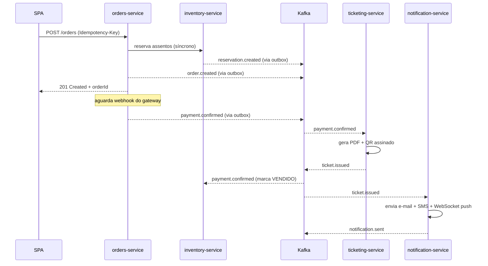

# 03 — Estrutura de Mensageria Kafka

> Topologia de tópicos, particionamento, retenção, schemas e padrões de produção/consumo adotados no BolsoPass.
> O contrato formal (AsyncAPI 2.6) está em [`especificacoes-ia/specs/asyncapi-kafka.yaml`](../Pacote%201%20-%20Processo%20de%20Desenvolvimento%20e%20Requisitos/especificacoes-ia/specs/asyncapi-kafka.yaml).

---

## 1. Cluster

| Item | Decisão |
|---|---|
| Versão | Apache Kafka 3.7 (imagem `confluentinc/cp-kafka:7.6`) |
| Modo | **KRaft** (sem Zookeeper) |
| Brokers | 1 em dev / 3 em produção simulada |
| Replication factor | `1` em dev / `3` em prod |
| `min.insync.replicas` | `1` em dev / `2` em prod |
| `acks` do producer | `all` para tópicos transacionais |
| Schema Registry | Confluent Schema Registry (opcional — JSON Schema no Pacote 3) |
| UI | AKHQ em `http://localhost:8089` |

---

## 2. Catálogo de tópicos

| Tópico | Produtor | Consumidores | Partições | Retenção | Chave de particionamento |
|---|---|---|---:|---|---|
| `reservation.created` | inventory-service | orders, telemetry | 12 | 7d | `reservation_id` |
| `reservation.expired` | inventory-service | orders, telemetry | 12 | 7d | `reservation_id` |
| `reservation.released` | inventory-service | telemetry | 12 | 7d | `reservation_id` |
| `order.created` | orders-service | telemetry | 12 | 7d | `order_id` |
| `order.payment_requested` | orders-service | (gateway simulado) | 6 | 7d | `order_id` |
| `payment.confirmed` | orders-service (via webhook) | ticketing, inventory, telemetry | 12 | 30d | `order_id` |
| `payment.failed` | orders-service | inventory (release), telemetry | 6 | 7d | `order_id` |
| `ticket.issued` | ticketing-service | notification, telemetry | 12 | 30d | `order_id` |
| `ticket.scanned` | ticketing-service | telemetry | 6 | 30d | `ticket_id` |
| `notification.sent` | notification-service | telemetry | 3 | 7d | `order_id` |
| `audit.event` | iam-service, orders-service, inventory-service | telemetry (sink) | 6 | 90d | `aggregate_id` |
| `_dlq.<tópico-origem>` | (consumidor que falhou) | ops (manual) | 3 | 30d | igual ao original |

### Convenções de nomenclatura

- `<aggregate>.<action-past-tense>` — todos em **passado** (eventos, não comandos).
- DLQ: prefixo `_dlq.` seguido do tópico de origem.
- Nenhum tópico em maiúsculas; `kebab.case` reservado para separação lógica.

---

## 3. Schema de evento (envelope padrão)

Todo evento publicado segue o envelope abaixo (JSON Schema simplificado):

```json
{
  "eventId": "01HQZ...",         // ULID — único por evento (chave de idempotência)
  "eventType": "payment.confirmed",
  "eventVersion": "1.0",
  "occurredAt": "2026-11-10T18:03:21.123Z",
  "producer": "orders-service",
  "traceId": "4bf92f3577b34da6a3ce929d0e0e4736",
  "aggregateType": "Order",
  "aggregateId": "01HQ...",
  "payload": { /* específico do eventType */ }
}
```

### Headers Kafka obrigatórios

| Header | Significado |
|---|---|
| `event-id` | duplicata do `eventId` do envelope (facilita o consumer filtrar sem desserializar) |
| `event-type` | duplicata do `eventType` |
| `trace-id` | propagação de traço (W3C) |
| `content-type` | `application/json` |

---

## 4. Produção segura — Transactional Outbox

Nenhum serviço produz direto do fluxo síncrono. O padrão aplicado é:

1. O caso de uso grava a mutação de domínio **+ linha em `outbox_messages`** na **mesma transação ACID**.
2. O `OutboxRelayWorker` (`@Scheduled(fixedDelay=200ms)`) consulta `WHERE published_at IS NULL ORDER BY created_at LIMIT 500 FOR UPDATE SKIP LOCKED`.
3. Para cada linha: publica no Kafka com `acks=all`, obtém o offset, atualiza `published_at = NOW()`.
4. Em caso de crash entre publicar e marcar, o mesmo `eventId` será reenviado — e deduplicado no consumidor.

**Garantia**: *at-least-once* na saída + *effectively-once* na recepção.

---

## 5. Consumo seguro — Idempotência

Todo consumidor:

1. Inicia transação no banco local.
2. `INSERT INTO processed_messages (message_id, consumer_group) VALUES (?, ?) ON CONFLICT DO NOTHING RETURNING *`.
3. Se **nenhuma linha retornada** → já processado → `commit` e `ack`.
4. Senão → executa a lógica de negócio na **mesma transação** → `commit`.
5. Faz `commit` do offset Kafka **só após** o commit do banco.

### Configurações de consumer

| Config | Valor |
|---|---|
| `enable.auto.commit` | `false` |
| `isolation.level` | `read_committed` |
| `max.poll.records` | `50` |
| `session.timeout.ms` | `30000` |
| `retries do processamento` | 3 (backoff exponencial 1s/5s/25s) → DLQ |

---

## 6. Fluxo coreográfico do checkout



---

## 7. Dead Letter Queue (DLQ)

Toda falha após 3 tentativas vai para `_dlq.<tópico-origem>` com headers extras:

- `original-topic`, `original-partition`, `original-offset`
- `failure-reason` (classe da exceção)
- `failure-stacktrace` (truncada em 4KB)
- `failed-at` (ISO 8601)

O time de ops inspeciona via AKHQ e usa um utilitário `dlq-replay` (CLI Spring) para reinjetar após correção.

---

## 8. Grupos de consumidores

| Consumer group | Serviço | Tópicos |
|---|---|---|
| `orders-reservation` | orders-service | `reservation.expired` |
| `orders-payment` | orders-service | (webhook, não Kafka) |
| `inventory-payment` | inventory-service | `payment.confirmed`, `payment.failed` |
| `ticketing-payment` | ticketing-service | `payment.confirmed` |
| `notification-ticket` | notification-service | `ticket.issued` |
| `telemetry-all` | telemetry-service | assinatura por padrão `*` (regex) |

---

## 9. Observabilidade

- **Métricas**: `kafka_producer_record_send_total`, `kafka_consumer_fetch_latency_avg`, `kafka_consumer_records_lag` por tópico (Prometheus).
- **Alertas**: lag > 10k mensagens, DLQ > 0, idade do outbox > 5s.
- **Dashboards Grafana**: throughput por tópico, latência fim-a-fim do checkout, taxa de duplicatas filtradas pelo `processed_messages`.
