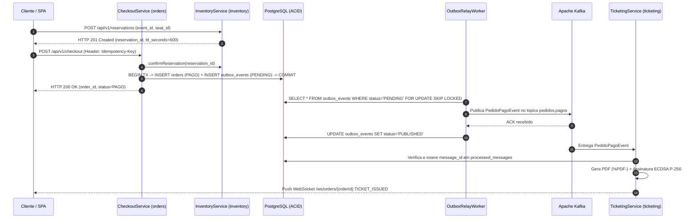

# 03 — Estrutura de Mensageria Kafka

> [!abstract] Resumo da Espinha Dorsal Assíncrona
> Especificação da topologia de tópicos, particionamento, retenção, esquemas de eventos e padrões de produção ([Transactional Outbox](https://microservices.io/patterns/data/transactional-outbox.html)) e consumo idempotente adotados no [[00 - Visao Geral e Indice (MOC)|BolsoPass]]. O contrato formal [AsyncAPI 2.6](https://www.asyncapi.com/) encontra-se em `Pacote 1 - Processo de Desenvolvimento e Requisitos/especificacoes-ia/specs/asyncapi-kafka.yaml` e sua implementação executável está em `src/main/java/com/bolsopass/`.

---

## 1. Configuracao do Cluster

| Parâmetro | Decisão Arquitetural |
| :--- | :--- |
| **Versão do Broker** | [Apache Kafka 3.7](https://kafka.apache.org/) (imagem `confluentinc/cp-kafka:7.6`) |
| **Modo de Coordenação** | **KRaft** (sem dependência de ZooKeeper) |
| **Garantia de Escrita (`acks`)** | `acks=all` para todos os produtores transacionais |
| **Semântica de Entrega** | *At-Least-Once* no broker + *Effectively-Once* no consumidor via tabela `processed_messages` |
| **Interface de Inspeção** | AKHQ em `http://localhost:8089` |

---

## 2. Catalogo Padronizado de Topicos e Contratos

Os tópicos abaixo harmonizam o contrato AsyncAPI 2.6 (`.agents/specs/asyncapi-kafka.yaml`), a skill `kafka-contracts` e as classes implementadas no Pacote 3:

| Tópico Kafka | Chave de Particionamento | Classe de Evento no Pacote 3 | Produtor | Consumidores | Partições | Retenção |
| :--- | :--- | :--- | :--- | :--- | :---: | :---: |
| **`pedidos.pagos`** | `order_id` | `orders.domain.PedidoPagoEvent` | `orders-service` (`OutboxRelayWorker`) | `ticketing-service` (`TicketingService`), `telemetry-service` | 12 | 30d |
| **`reservas.expiradas`** | `event_id` | `inventory.domain.ReservaExpiradaEvent` | `inventory-service` (`SeatInventory`) | `orders-service`, `notification-service` (WS), `telemetry-service` | 12 | 7d |
| **`reservas.criadas`** | `event_id` | `inventory.domain.Reservation` | `inventory-service` | `orders-service`, `telemetry-service` | 12 | 7d |
| **`pedidos.cancelados`** | `order_id` | `orders.domain.Order` | `orders-service` (Outbox) | `inventory-service` (liberação de assento), `telemetry-service` | 6 | 7d |
| **`telemetria.eventos`** | `session_id` | `telemetry.domain.TelemetrySnapshot` | Gateway / Serviços | `telemetry-service` | 6 | 7d |
| **`_dlq.<topico>`** | igual ao tópico de origem | Envelope com stacktrace de falha | Consumidor após esgotar retentativas | Operações / SRE (`dlq-replay`) | 3 | 30d |

---

## 3. Esquemas de Payload (Conformidade com AsyncAPI 2.6)

### 3.1 Tópico `pedidos.pagos` (`PedidoPagoEvent`)
Publicado pelo `OutboxRelayWorker` após o commit ACID do pagamento no PostgreSQL:

```json
{
  "order_id": "7b9e8312-d9f2-4b2a-a9e1-e63d865cfa99",
  "client_id": "11111111-1111-1111-1111-111111111111",
  "event_id": "3fa85f64-5717-4562-b3fc-2c963f66afa6",
  "seat_id": "A-15",
  "amount_cents": 38500,
  "paid_at": "2026-11-23T20:55:00Z"
}
```

### 3.2 Tópico `reservas.expiradas` (`ReservaExpiradaEvent`)
Publicado quando o TTL estrito de 10 minutos ($600\text{ segundos}$) de uma reserva expira sem confirmação de pagamento:

```json
{
  "event_id": "3fa85f64-5717-4562-b3fc-2c963f66afa6",
  "seat_id": "B-04",
  "reservation_id": "8e11c401-6a21-4c93-9111-94a3f1120001",
  "expired_at": "2026-11-23T20:10:00Z"
}
```

---

## 4. Producao Confiavel — Transactional Outbox (`OutboxRelayWorker`)

Nenhum fluxo HTTP de checkout publica diretamente no Kafka durante a transação do usuário. O mecanismo implementado em `CheckoutService` e `OutboxRelayWorker` segue três passos:

1. **Gravação Atômica Relacional:** O método `CheckoutService.processCheckout(...)` (`@Transactional`) grava `OrderEntity` (com `status = 'PAGO'`) na tabela `orders` e `OutboxEventEntity` (com `status = 'PENDING'` e `topic = 'pedidos.pagos'`) na tabela `outbox_events` dentro da **mesma transação ACID**.
2. **Polling Concorrente sem Contenção:** O `OutboxRelayWorker` consulta `outbox_events` utilizando a cláusula `FOR UPDATE SKIP LOCKED` do PostgreSQL (`OutboxEventRepository.findPendingBatchForUpdateSkipLocked()`):
   ```sql
   SELECT * FROM outbox_events
   WHERE status = 'PENDING'
   ORDER BY created_at ASC
   LIMIT 100
   FOR UPDATE SKIP LOCKED
   ```
3. **Confirmação de Publicação:** Para cada registro, envia a mensagem via `KafkaTemplate.send(topic, aggregateId, payload)`, aguarda o ACK síncrono do broker e atualiza `status = 'PUBLISHED'` e `published_at = NOW()`. Caso o broker Kafka esteja temporariamente inacessível, o registro permanece `PENDING` no PostgreSQL e é despachado automaticamente assim que o cluster se recupera (`0%` de perda de eventos, comprovado em `TransactionalOutboxIntegrationTest`).

---

## 5. Consumo Idempotente — Tabela `processed_messages` (`TicketingService`)

Para absorver duplicatas decorrentes da entrega *At-Least-Once*, o consumidor `TicketingService` (`consumer_group = "ticketing-payment"`) executa o protocolo de deduplicação em `consumeOrderPaidIdempotently(messageId, event)`:

1. Consulta `processedMessageRepository.existsById(messageId)` na tabela `processed_messages(message_id, consumer_group, processed_at)`.
2. Se o `message_id` já existir, aborta imediatamente como *no-op* idempotente (`Optional.empty()`), evitando gerar um segundo PDF ou enviar notificações duplicadas.
3. Caso contrário, persiste o `ProcessedMessageEntity`, gera o ingresso PDF com QR Code assinado com ECDSA P-256 (`TicketCryptoSigner`) e dispara a notificação WebSocket para `/ws/orders/{orderId}`.

---

## 6. Diagrama de Sequencia Fim a Fim (Validado no Pacote 3)


