# 04 — Pipeline de Desenvolvimento (CI/CD)

> Pipeline automatizada em **GitHub Actions** executada a cada *Pull Request* e *Merge* em `develop`.

---

## 1. Visão geral

```mermaid
flowchart LR
  PR[Pull Request<br/>em develop]
  LINT[Lint & Format]
  BUILD[Build]
  UT[Testes Unitários]
  IT[Testes de Integração<br/>Testcontainers]
  COV[Coverage ≥ 70%]
  SAST[SAST / SCA<br/>Trivy + Dependabot]
  IMG[Build Docker Image]
  PUSH[Push para GHCR]
  DEPLOY[Deploy em staging<br/>via docker-compose]

  PR --> LINT --> BUILD --> UT --> IT --> COV --> SAST
  SAST -->|merge em develop| IMG --> PUSH --> DEPLOY
```



---

## 2. Stages detalhadas

### 2.1 Lint & Format (bloqueante)

| Linguagem | Ferramenta | Comando |
|---|---|---|
| Java | **Checkstyle** + **Spotless** | `./mvnw spotless:check checkstyle:check` |
| TypeScript/React | **ESLint** + **Prettier** | `pnpm lint && pnpm format:check` |
| Dockerfiles | **hadolint** | `hadolint **/Dockerfile` |
| YAML | **yamllint** | `yamllint .` |
| Commits | **commitlint** (Conventional Commits) | `commitlint --from=origin/develop` |

### 2.2 Build

- **Backend**: `./mvnw -B -ntp verify -DskipTests` em cada módulo (`mvn-reactor` do monorepo).
- **Frontend**: `pnpm build` (gera `dist/`).
- Falha de compilação **aborta** a pipeline.

### 2.3 Testes unitários

- **Backend**: JUnit 5 + Mockito + AssertJ — `./mvnw test`.
- **Frontend**: Vitest — `pnpm test:unit`.
- Cobertura mínima: **70% em pacotes de domínio** (`com.bolsopass.*.domain.*`) — enforced via **JaCoCo** com `coverage-check`.

### 2.4 Testes de integração (Testcontainers)

- Spins up reais de **PostgreSQL 16**, **Kafka 3.7 (KRaft)** e **Redis 7** por módulo.
- Rodam contra o cluster real do GitHub-hosted runner (Linux, Docker-in-Docker).
- Timeout agressivo por teste (30s) para evitar flake.
- Comando: `./mvnw -Pit verify`.

### 2.5 Testes E2E (opcional/noturno)

- **Playwright** rodando contra o `docker-compose up` completo.
- Executado em workflow separado `nightly-e2e.yml` (cron 02:00 UTC-3).

### 2.6 Análise de segurança (SAST / SCA)

| Verificação | Ferramenta |
|---|---|
| Vulnerabilidades em dependências | **Dependabot** + `./mvnw org.owasp:dependency-check-maven:check` |
| Secrets em código | **gitleaks** |
| Imagens Docker | **Trivy** (`trivy image ghcr.io/bolsopass/...`) |
| Qualidade de código | **SonarCloud** (opcional) |

### 2.7 Build & push de imagens Docker

- Multi-stage Dockerfile para cada microsserviço (`eclipse-temurin:21-jre-alpine` como base final).
- Tag: `ghcr.io/<org>/<service>:${{ github.sha }}` + `:develop` em merges em develop.
- Assinatura das imagens com **Cosign** (opcional).

### 2.8 Deploy em staging

- Workflow `deploy-staging.yml` dispara em `push` para `develop`.
- SSH em VM de staging (ou execução local em docker-compose) com `docker compose pull && docker compose up -d`.
- Smoke test via `curl` em endpoints de healthcheck.

---

## 3. Matriz de triggers

| Evento | Lint | Build | UT | IT | SAST | Imagem | Deploy |
|---|:---:|:---:|:---:|:---:|:---:|:---:|:---:|
| Push em qualquer branch | ✅ | ✅ | ✅ | — | — | — | — |
| Pull Request → `develop` | ✅ | ✅ | ✅ | ✅ | ✅ | — | — |
| Merge em `develop` | ✅ | ✅ | ✅ | ✅ | ✅ | ✅ | ✅ (staging) |
| Tag `v*.*.*` em `main` | ✅ | ✅ | ✅ | ✅ | ✅ | ✅ (`:vX.Y.Z`) | ✅ (prod) |
| Cron noturno | — | — | — | ✅ | ✅ (full) | — | — |

---

## 4. Estrutura dos workflows (`.github/workflows/`)

```
.github/workflows/
├── ci.yml              # lint + build + UT (todo push)
├── pr-checks.yml       # IT + SAST + coverage (só PR → develop)
├── deploy-staging.yml  # merge em develop
├── release.yml         # tag v*.*.* em main
└── nightly-e2e.yml     # Playwright full flow
```

### Exemplo — `ci.yml` (esqueleto)

```yaml
name: CI
on: [push]
jobs:
  lint:
    runs-on: ubuntu-latest
    steps:
      - uses: actions/checkout@v4
      - uses: actions/setup-java@v4
        with: { java-version: '21', distribution: 'temurin' }
      - run: ./mvnw -B spotless:check checkstyle:check
  build-test:
    needs: lint
    runs-on: ubuntu-latest
    steps:
      - uses: actions/checkout@v4
      - uses: actions/setup-java@v4
        with: { java-version: '21', distribution: 'temurin' }
      - run: ./mvnw -B -ntp verify
      - uses: codecov/codecov-action@v4
```

---

## 5. Cache e performance

- Cache do `~/.m2/repository` (Maven) por `hashFiles('**/pom.xml')`.
- Cache do store do `pnpm` por `hashFiles('pnpm-lock.yaml')`.
- Testcontainers com `reuse=true` entre jobs sequenciais do mesmo workflow.
- Matriz de módulos paralelos quando houver >5 serviços.

---

## 6. Enforcement no GitHub

**Branch protection rules** em `develop` e `main`:

- Require pull request before merging.
- Require status checks to pass: `lint`, `build-test`, `pr-checks/integration`, `pr-checks/coverage`.
- Require branches to be up to date.
- Require conversation resolution.
- Require signed commits (recomendado).
- No force push.
