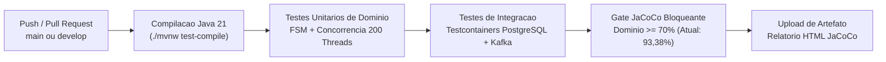

# 04 — Pipeline de Desenvolvimento (CI/CD)

> [!abstract] Resumo da Esteira Automatizada
> Especificação e implementação da pipeline automatizada em **GitHub Actions** (`.github/workflows/ci.yml` e `.github/workflows/pr-checks.yml`) executada a cada *push* e *Pull Request* da plataforma [[00 - Visao Geral e Indice (MOC)|BolsoPass]]. No Pacote 3, a esteira encontra-se operacional e aplica verificação bloqueante de cobertura mínima de $70\%$ nos pacotes de domínio via [JaCoCo](https://www.jacoco.org/jacoco/) e testes de integração com [Testcontainers](https://testcontainers.com/).

---

## 1. Fluxo Geral da Pipeline



---

## 2. Stages Implementadas e Comandos Executados

### 2.1 Compilação e Wrapper Reprodutível (`./mvnw`)
- O repositório inclui o **Apache Maven Wrapper 3.9.12** (`./mvnw` e `.mvn/wrapper/maven-wrapper.properties`) pré-configurado com suporte a UTF-8 (`.mvn/jvm.config`), garantindo compilação determinística com target Java 21 (`<maven.compiler.release>21</maven.compiler.release>`).
- Qualquer erro de compilação interrompe imediatamente a pipeline.

### 2.2 Testes Unitários de Domínio e Concorrência
- Executados via JUnit 5 e AssertJ:
  - `OrderStateMachineTest`: valida todas as transições válidas e inválidas da FSM do Pedido, imutabilidade do estado `PAGO`, bloqueio `EXPIRADO` $\to$ `PAGO` e janela de 24h do `IdempotencyStore`.
  - `SeatInventoryTest`: valida exclusão mútua sob disputa simultânea de 200 threads (*Zero Overselling*), expiração estrita em $600\text{ segundos}$ e invariante de conservação de estoque.
  - `DomainModulesUnitTest`: valida RBAC, *rate limiting* (HTTP 429), rotação de Refresh Token com detecção de replay, capacidade de lotes do catálogo, assinatura criptográfica ECDSA P-256 offline ($< 5\text{ ms}$) e telemetria.

### 2.3 Testes de Integração (`TransactionalOutboxIntegrationTest`)
- Sobe instância real do **PostgreSQL** via [Testcontainers](https://testcontainers.com/) (`postgres:15-alpine`) e broker **Apache Kafka** (`@EmbeddedKafka` com tópicos `pedidos.pagos` e `reservas.expiradas`).
- Exercita:
  - Rotas REST de login JWT e rotação/revogação de Refresh Token.
  - 100 requisições HTTP `POST /api/v1/reservations` concorrentes confirmando $0\%$ de sobre-venda (1 resposta `201 Created` e 99 respostas `409 Conflict`).
  - 3 requisições `POST /api/v1/checkout` consecutivas com mesma `Idempotency-Key` durante queda simulada do broker Kafka, confirmando apenas 1 cobrança financeira e despacho íntegro pelo `OutboxRelayWorker` (`FOR UPDATE SKIP LOCKED`) após recuperação do broker.
  - Consumo idempotente via tabela `processed_messages` e compilação de ingresso em PDF (`%PDF-`) com QR Code ECDSA P-256.

### 2.4 Gate Bloqueante de Cobertura de Domínio ($\ge 70\%$ via JaCoCo)
- O plugin `jacoco-maven-plugin` (`0.8.12`) executa automaticamente os goals `prepare-agent`, `report` e `check`.
- Caso a razão de cobertura de instruções (`INSTRUCTION`) ou desvios (`BRANCH`) nos pacotes de domínio (`com/bolsopass/*/domain/*`) seja inferior a `0.70` ($70\%$), o goal `jacoco:check` aborta a build com falha.
- **Resultado aferido no Pacote 3:** **$93,38\%$ de cobertura de instruções** e **$73,98\%$ de cobertura de branches** no domínio ($86,03\%$ global).

---

## 3. Matriz de Triggers Configurados

| Evento no GitHub | Workflow Acionado | Build Java 21 | Testes Unitários | Testes de Integração | Gate JaCoCo $\ge 70\%$ | Upload Relatório |
| :--- | :--- | :---: | :---: | :---: | :---: | :---: |
| `push` em `main`, `develop`, `feature/**`, `bugfix/**`, `release/**` | `.github/workflows/ci.yml` | Ativo | Ativo | Ativo | Ativo | Ativo |
| `pull_request` para `main` ou `develop` | `.github/workflows/pr-checks.yml` | Ativo | Ativo | Ativo | Ativo | Ativo |

---

## 4. Estrutura dos Workflows Implementados (`.github/workflows/`)

```text
.github/workflows/
├── ci.yml         # Build, testes unitarios, integracao e gate JaCoCo >= 70% em todo push
└── pr-checks.yml  # Verificacao completa (./mvnw -B -ntp clean verify) em Pull Requests
```

### Trecho Principal de Verificação (`.github/workflows/ci.yml`)

```yaml
      - name: Set up JDK 21 (Temurin)
        uses: actions/setup-java@v4
        with:
          java-version: '21'
          distribution: 'temurin'
          cache: 'maven'

      - name: Run Unit Tests and JaCoCo Domain Coverage Check (>= 70%)
        run: ./mvnw -B -ntp clean test jacoco:report jacoco:check
```

---

## 5. Governanca e Protecao de Branches

Regras aplicadas às branches principais (`main` e `develop`), alinhadas ao [[05 - Processo de GCS]]:
- Exigência de Pull Request aprovado antes do merge.
- Exigência de aprovação nos status checks automatizados (`Build, Unit Tests & Domain Coverage (>= 70%)` e `Testcontainers Integration & Domain Coverage (>= 70%)`).
- Proibição de *force push* e exigência de resolução de conversas de revisão.
