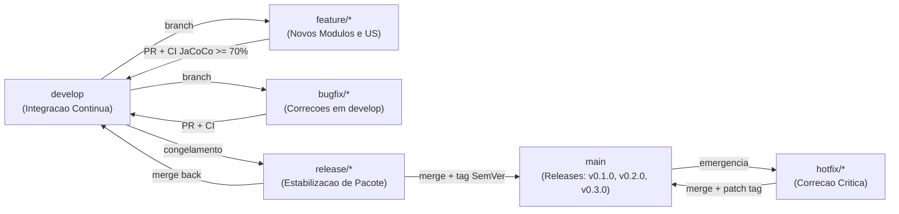

# 05 — Processo de GCS (Gerenciamento da Configuracao de Software)

> [!abstract] Resumo de Governança de Configuração
> Define a ferramenta de controle de versão, a estrutura do monorepo, o fluxo de branches (*GitFlow adaptado*), a convenção de mensagens de commit (*Conventional Commits*) e a política de versionamento semântico adotada na plataforma [[00 - Visao Geral e Indice (MOC)|BolsoPass]].

---

## 1. Ferramenta e Estrutura do Repositorio

| Item de Configuração | Decisão Adotada |
| :--- | :--- |
| **Sistema de Controle de Versão (SCM)** | Git |
| **Hospedagem e CI** | GitHub + GitHub Actions (`.github/workflows/`) |
| **Topologia de Repositório** | **Monorepo** contendo documentação Obsidian (Pacotes 1, 2 e 3), especificações formais OpenAPI/AsyncAPI, Agent Skills (`.agents/`), código-fonte Java 21 / Spring Boot (`src/`) e suítes de teste (`src/test/` e `tests/`) |
| **Branch Principal de Produção** | `main` (releases estáveis taggeadas) |
| **Branch de Integração Contínua** | `develop` (consolidação de features da próxima release) |

### Por que Monorepo no BolsoPass
1. **Sincronia entre Especificação e Código:** Permite que contratos OpenAPI 3.0, AsyncAPI 2.6, notas arquiteturais no Obsidian e classes Java de domínio evoluam de forma atômica no mesmo Pull Request.
2. **Verificação Unificada:** Um único comando (`./mvnw clean verify`) compila todos os contextos delimitados (`iam`, `catalog`, `inventory`, `orders`, `ticketing`, `telemetry`), executa os 22 testes automatizados e valida a cobertura JaCoCo $\ge 70\%$.

---

## 2. Modelo de Branches (GitFlow Adaptado)

### Convenção de Nomenclatura de Branches

| Prefixo | Finalidade | Exemplo Real no Projeto |
| :--- | :--- | :--- |
| `feature/` | Implementação de história de usuário ou módulo | `feature/orders-transactional-outbox` |
| `bugfix/` | Correção de defeito identificado em `develop` | `bugfix/inventory-ttl-clock-boundary` |
| `release/` | Preparação e auditoria de pacote avaliativo da PUCRS | `release/0.3.0` |
| `hotfix/` | Correção emergencial sobre tag publicada em `main` | `hotfix/qr-ecdsa-signature-verification` |
| `docs/` | Criação ou atualização de documentação e MOCs no cofre | `docs/pacote-3-rastreabilidade` |
| `chore/` | Manutenção de build, dependências Maven ou workflows CI | `chore/configure-jacoco-domain-rule` |

---

## 3. Fluxo de Contribuicao e Revisao (Code Review)

1. **Abertura de Tarefa / História:** Toda alteração referencia uma User Story (`US-01` a `US-18`) ou requisito (`RF-01` a `RF-18`, `RNF-01` a `RNF-08`) mapeado na [[08 - Matriz de Rastreabilidade e Pacotes de Entrega]].
2. **Desenvolvimento Orientado a Testes (TDD):** O desenvolvedor (em pareamento com o agente de IA, conforme [[01 - Processo de Desenvolvimento Suportado por IA]]) implementa os testes de domínio e o código de produção na branch `feature/<escopo>`.
3. **Validação Local com Maven Wrapper:** Execução de `./mvnw clean verify` garantindo zero falhas e cobertura JaCoCo $\ge 70\%$.
4. **Pull Request e Pipeline Automatizada:** Abertura de PR disparando `.github/workflows/pr-checks.yml`.
5. **Checklist de Code Review:**
   - A mudança preserva os invariantes de domínio (*Zero Overselling*, TTL de 600s, imutabilidade de `PAGO`, Transactional Outbox sem escrita dupla)?
   - Os testes cobrem o caminho feliz e as transições inválidas/exceções?
   - Nenhum segredo ou credencial foi incluído no código-fonte?
   - A documentação dos Pacotes 1, 2 e 3 foi atualizada caso algum contrato ou componente tenha evoluído?

---

## 4. Padrao de Mensagens de Commit (Conventional Commits)

Formato obrigatório: `<type>(<scope>): <subject>`

| Tipo (`type`) | Aplicação | Exemplo |
| :--- | :--- | :--- |
| `feat` | Nova funcionalidade de domínio ou endpoint | `feat(orders): implementa OrderStateMachine e OutboxRelayWorker` |
| `fix` | Correção de bug ou condição de corrida | `fix(inventory): garante devolucao atomica no segundo exato t=600s` |
| `test` | Adição ou melhoria de testes unitários e Testcontainers | `test(inventory): adiciona disputa concorrente com 200 virtual threads` |
| `docs` | Atualização de notas no Obsidian, diagramas C4 ou README | `docs(pacote3): atualiza matriz de rastreabilidade e cobertura JaCoCo` |
| `ci` | Configuração de workflows do GitHub Actions | `ci(actions): adiciona verificacao bloqueante jacoco:check em PRs` |
| `refactor` | Refatoração interna sem alterar contratos externos | `refactor(iam): extrai deteccao de replay para RefreshTokenFamily` |

---

## 5. Versionamento Semantico (SemVer 2.0.0) e Marcos de Entrega

O projeto adota [Semantic Versioning 2.0.0](https://semver.org/lang/pt-BR/) (`MAJOR.MINOR.PATCH`), associando cada pacote avaliativo da disciplina a uma release formal:

| Versão / Tag | Pacote Avaliativo PUCRS | Escopo Consolidado na Baseline | Status |
| :---: | :--- | :--- | :---: |
| **`v0.1.0`** | **Pacote 1 — Processo e Requisitos** | Processo com IA, Visão do Produto, 18 User Stories (Story Mapping + BDD), 8 RNFs (ISO 25010), FSM, Mockups High-Res e specs OpenAPI/AsyncAPI. | Concluído |
| **`v0.2.0`** | **Pacote 2 — Arquitetura e Infraestrutura** | Arquitetura C4 (Níveis 1, 2 e 3), Modelo de Dados Conceitual, Topologia Kafka, Pipeline CI/CD e Processo de GCS. | Concluído |
| **`v0.3.0`** | **Pacote 3 — Checkpoint do Desenvolvimento** | Implementação Java 21 / Spring Boot 3.3 dos 5 módulos (`src/`), 22 testes automatizados com Testcontainers e cobertura de domínio de **$93,38\%$ de instruções e $73,98\%$ de branches** no JaCoCo, workflows `.github/workflows/` e documentação atualizada. | Concluído |
| **`v1.0.0`** | **Pacote 4 — Produto Completo** | Orquestração integral via `docker-compose.yml` unificado e homologação fim a fim de todos os contêineres. | Planejado |
