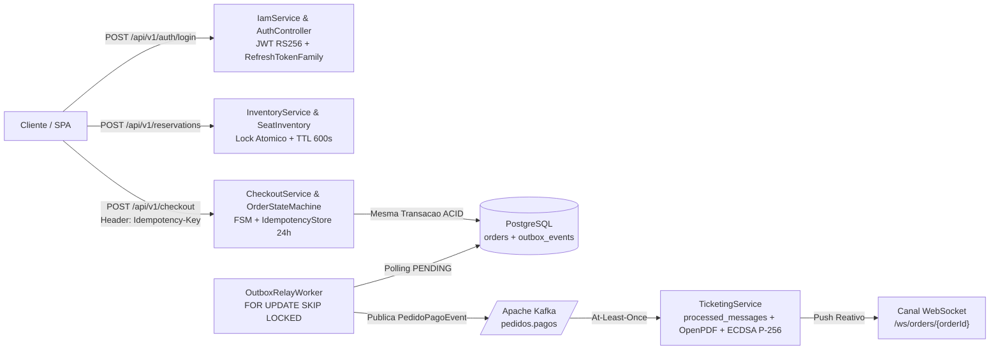

# Pacote 3: Checkpoint do Desenvolvimento e Validacao Automatizada

> [!abstract] Resumo Executivo do Pacote 3
> Este Mapa de Conteúdo (MOC) consolida os entregáveis técnicos do **Pacote 3 (Checkpoint do Desenvolvimento)** da plataforma [[00 - Visao Geral e Indice (MOC)|BolsoPass]] para a disciplina de Construção de Software da Escola Politécnica da PUCRS (2026/2). O pacote materializa a implementação funcional dos módulos de domínio, APIs RESTful, persistência transacional com o padrão [Transactional Outbox](https://microservices.io/patterns/data/transactional-outbox.html), emissão criptográfica de ingressos em PDF com assinatura assimétrica ECDSA P-256 e uma suíte completa de testes unitários e de integração com cobertura de domínio superior ao limiar mínimo de $70\%$ aferida via [JaCoCo](https://www.jacoco.org/jacoco/) e [Testcontainers](https://testcontainers.com/).

---

## 1. Mapa de Conteudo do Pacote 3

Os documentos abaixo detalham a arquitetura implementada no código-fonte (`src/main/java/com/bolsopass/`), a estratégia de verificação automatizada (`src/test/java/com/bolsopass/` e `tests/`) e a evolução contínua em relação aos artefatos estabelecidos no Pacote 1 e no Pacote 2:

| Documento | Foco e Escopo Técnico | Status |
| :--- | :--- | :--- |
| [[01 - Implementacao dos Microsservicos e Dominio]] | Mapeamento entre o código-fonte implementado em Java 21 / Spring Boot 3.3 e os cinco módulos autônomos (IAM, Catálogo/Inventário, Pedidos/Outbox, Ingressos/Despacho e Telemetria). | Concluído |
| [[02 - Suite de Testes e Cobertura de Dominio JaCoCo]] | Detalhamento dos testes unitários da Máquina de Estados Finitos (`OrderStateMachineTest`), concorrência de assentos (`SeatInventoryTest`) e relatório de cobertura JaCoCo ($\ge 70\%$). | Concluído |
| [[03 - Testes de Integracao Testcontainers e Pipeline CI]] | Validação empírica do Transactional Outbox sob falha do broker Apache Kafka, deduplicação `Idempotency-Key` e `processed_messages`, e esteira GitHub Actions (`.github/workflows/`). | Concluído |

---

## 2. Atendimento aos Requisitos do Enunciado para o Pacote 3

O enunciado oficial da disciplina define três pilares obrigatórios para o Checkpoint do Desenvolvimento, integralmente cumpridos e rastreáveis neste repositório:

1. **Estágio Corrente de Desenvolvimento Funcional da Plataforma:**
   - Implementação executável em Java 21 e [Spring Boot 3.3](https://spring.io/projects/spring-boot) estruturada por contextos delimitados (*Bounded Contexts*) sob `src/main/java/com/bolsopass/`:
     - `com.bolsopass.iam`: Autenticação stateless com tokens JWT assinados com RSA-2048 (RS256), controle de acesso baseado em papéis (`ROLE_CLIENT`, `ROLE_ORGANIZER`, `ROLE_OPERATOR`, `ROLE_ADMIN`), bloqueio contra força bruta (*rate limiting* após 5 falhas em 1 minuto) e rotação de Refresh Tokens com detecção de reuso malicioso (`RefreshTokenFamily`).
     - `com.bolsopass.catalog` e `com.bolsopass.inventory`: Gestão de eventos e lotes com validação de capacidade (`EventCatalogItem`), alocação atômica de assentos numerados com tolerância zero a sobre-venda (`SeatInventory`, `Seat`), expiração estrita em 10 minutos ($600\text{ s}$) e publicação de `ReservaExpiradaEvent`.
     - `com.bolsopass.orders`: Máquina de Estados Finitos formal do pedido (`OrderStateMachine`, `Order`), filtro de idempotência de 24 horas para o cabeçalho `Idempotency-Key` (`IdempotencyStore`), persistência atômica relacional (`OrderEntity` + `OutboxEventEntity`) e worker assíncrono de despacho (`OutboxRelayWorker`) com cláusula `FOR UPDATE SKIP LOCKED`.
     - `com.bolsopass.ticketing`: Consumidor Kafka idempotente apoiado na tabela relacional `processed_messages` (`ProcessedMessageEntity`), geração de documentos PDF com [OpenPDF](https://github.com/LibrePDF/OpenPDF) e QR Code [ZXing](https://github.com/zxing/zxing), assinatura digital assimétrica ECDSA P-256 (`TicketCryptoSigner`), validação offline na portaria com prevenção de dupla entrada (`DigitalTicket`) e notificações reativas em canal WebSocket (`/ws/orders/{orderId}`).
     - `com.bolsopass.telemetry`: Agregação atômica de métricas de vazão, conversão do funil de checkout, receita acumulada e auditoria de zero sobre-venda (`TelemetrySnapshot`).
2. **Documentação dos Pacotes 1 e 2 Atualizada:**
   - Atualização da [[08 - Matriz de Rastreabilidade e Pacotes de Entrega]], do `README.md` principal e dos documentos arquiteturais do Pacote 2 para refletir a conclusão do Pacote 3 e o mapeamento direto para as classes e testes implementados.
3. **Cobertura de Testes Unitários de Domínio e Máquinas de Estado ($\ge 70\%$):**
   - Aferição automatizada e bloqueante no `pom.xml` via plugin `jacoco-maven-plugin` exigindo razão mínima de cobertura de instruções e branches de $70\%$ (`0.70`) sobre os pacotes de domínio `com.bolsopass.*.domain.*`.

---

## 3. Fluxo Arquitetural Implementado no Checkpoint

