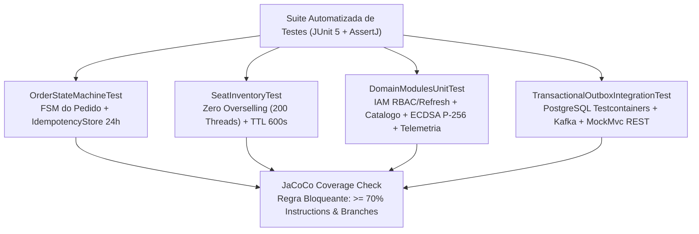

# Suite de Testes e Cobertura de Dominio JaCoCo

> [!important] Cumprimento da Meta Obrigatória de Cobertura ($\ge 70\%$)
> O enunciado do projeto e o requisito não-funcional [[04 - Requisitos Nao-Funcionais (RNFs)#RNF-07|RNF-07]] determinam que a suíte de testes unitários atinja **no mínimo 70% de cobertura** nos agregados de domínio e nas máquinas de estado. No Pacote 3, essa regra é verificada automaticamente pelo plugin [JaCoCo](https://www.jacoco.org/jacoco/) durante a fase `verify` do Maven (`jacoco:check`), falhando a build caso a cobertura de instruções ou branches nos pacotes `com.bolsopass.*.domain.*` fique abaixo de $70\%$.

---

## 1. Arquitetura da Suite de Testes

A suíte automatizada foi projetada seguindo a estratégia definida em [[01 - Processo de Desenvolvimento Suportado por IA]], combinando testes unitários determinísticos (com injeção de `java.time.Clock`) e testes de estresse multithread com `ExecutorService` e `CountDownLatch`:



---

## 2. Detalhamento dos Cenarios de Teste Unitario de Dominio

### 2.1 Máquina de Estados Finitos e Idempotência (`OrderStateMachineTest`)
Localizada em `src/test/java/com/bolsopass/orders/domain/OrderStateMachineTest.java`, exercita exaustivamente as regras de [[06 - Maquinas de Estados e Regras de Negocio]]:

| Cenário Testado | Método de Teste | Comportamento Verificado |
| :--- | :--- | :--- |
| **Caminho Feliz Completo** | `shouldTransitionThroughHappyPathToPaid` | Verifica a sequência `CRIADO` $\to$ `RESERVADO` $\to$ `AGUARDANDO_PAGAMENTO` $\to$ `PAGO` e a emissão do evento `PedidoPagoEvent`. |
| **Imutabilidade do Estado Terminal `PAGO`** | `shouldRejectAnyTransitionFromTerminalPaidState` | Assevera que um pedido `PAGO` rejeita transições para qualquer um dos 7 estados da enumeração com `InvalidOrderStateTransitionException`. |
| **Proibição de `EXPIRADO` $\to$ `PAGO`** | `shouldNeverAllowExpiredOrderToTransitionToPaid` | Comprova a invariante da história `US-08`: um pedido expirado jamais pode ser pago. |
| **Expiração Automática no Pagamento Tardio** | `shouldExpireAndRejectPaymentWhenTenMinutesTtlExceeded` | Ao tentar confirmar o pagamento no segundo $t = 600\text{ s}$, o pedido transiciona para `EXPIRADO` e lança `ReservationExpiredException`. |
| **Retentativa após Cartão Recusado** | `shouldAllowRetryFromDeclinedWithinTtlWindow` | Comprova a história `US-11`: transição `AGUARDANDO_PAGAMENTO` $\to$ `RECUSADO` $\to$ `AGUARDANDO_PAGAMENTO` $\to$ `PAGO` dentro dos 10 minutos. |
| **Cancelamentos e Bloqueio Pós-Cancelamento** | `shouldSupportValidCancellationsAndBlockTransitionsAfterCancelled` | Valida cancelamentos a partir de `CRIADO`, `RESERVADO` e `RECUSADO` e a terminalidade do estado `CANCELADO`. |
| **Rejeição de Saltos Ilegais** | `shouldRejectIllegalDirectStateJumps` | Impede saltos diretos como `CRIADO` $\to$ `PAGO` ou `RESERVADO` $\to$ `PAGO`. |
| **Idempotência 24h e Conflito de Payload** | `shouldDeduplicateWithin24HoursAndDetectPayloadConflict` | Verifica cache de 24h, bloqueio `409 Conflict` em requisições paralelas (`PROCESSING`) e rejeição de reuso de chave com payload adulterado. |

---

### 2.2 Alocação Concorrente e Expiração Estrita de 10 Minutos (`SeatInventoryTest`)
Localizada em `src/test/java/com/bolsopass/inventory/domain/SeatInventoryTest.java`, valida os invariantes de estoque:

| Cenário Testado | Método de Teste | Comportamento Verificado |
| :--- | :--- | :--- |
| **Disputa Concorrente Massiva (Zero Overselling)** | `shouldGuaranteeZeroOversellingUnderHighConcurrency` | Dispara **200 threads simultâneas** sincronizadas por `CountDownLatch` tentando reservar o assento `"A-12"`. Comprova que **exatamente 1** reserva é criada e **199** lançam `SeatAlreadyReservedException` ($0,00\%$ de sobre-venda). |
| **Precisão Temporal do TTL de 10 Minutos** | `shouldEnforceStrictTenMinutesTtlAndPublishExpirationEvent` | Utilizando `Clock.fixed`, comprova que em $t = 599\text{ s}$ o assento permanece bloqueado e em $t = 600\text{ s}$ transiciona para `EXPIRADO`, devolve o assento para `DISPONIVEL` e emite `ReservaExpiradaEvent`. |
| **Ciclo Completo até a Catraca** | `shouldTransitionSeatFromAvailableToSoldAndUtilizedAtGate` | Valida `DISPONIVEL` $\to$ `RESERVADO_TEMPORARIO` $\to$ `VENDIDO` $\to$ `UTILIZADO` e impede liberação de assento já vendido. |
| **Devolução por Cancelamento ou Timeout** | `shouldReleaseSeatOnCancellationOrLatePaymentAttempt` | Garante a invariante de conservação de estoque após desistência ou tentativa de pagamento fora do prazo. |

---

### 2.3 Demais Módulos de Domínio (`DomainModulesUnitTest`)
Localizada em `src/test/java/com/bolsopass/domain/DomainModulesUnitTest.java`, cobre:
- **IAM (`UserAccount` e `RefreshTokenFamily`):** Validação de papéis RBAC, bloqueio automático de 1 minuto após 5 senhas incorretas (`AccountRateLimitedException`), rotação de Refresh Token e revogação integral da família de tokens ao detectar tentativa de replay de token já rotacionado (`RefreshTokenReuseException`).
- **Catálogo (`EventCatalogItem`):** Validação da invariante $\sum \text{quota} \le \text{capacidadeTotal}$ e ordenação temporal dos lotes.
- **Ingressos e Criptografia (`TicketCryptoSigner` e `DigitalTicket`):** Geração de assinatura ECDSA P-256 (`SHA256withECDSA`), verificação offline exclusivamente com a chave pública em tempo $< 300\text{ ms}$ e máquina de estados de leitura na portaria (`AUTORIZADO` no primeiro acesso, `DUPLICATA` na tentativa de dupla entrada e `INVALIDO` para QR Code adulterado).
- **Telemetria (`TelemetrySnapshot`):** Cálculo da taxa de conversão de checkout e contagem atômica de eventos.

---

## 3. Regra de Verificacao Automatica no Maven (`pom.xml`)

O plugin `jacoco-maven-plugin` está configurado no `pom.xml` para inspecionar todos os pacotes `com/bolsopass/*/domain/*` durante o comando `./mvnw verify`:

```xml
<rule>
    <element>BUNDLE</element>
    <includes>
        <include>com/bolsopass/*/domain/*</include>
    </includes>
    <limits>
        <limit>
            <counter>INSTRUCTION</counter>
            <value>COVEREDRATIO</value>
            <minimum>0.70</minimum>
        </limit>
        <limit>
            <counter>BRANCH</counter>
            <value>COVEREDRATIO</value>
            <minimum>0.70</minimum>
        </limit>
    </limits>
</rule>
```

