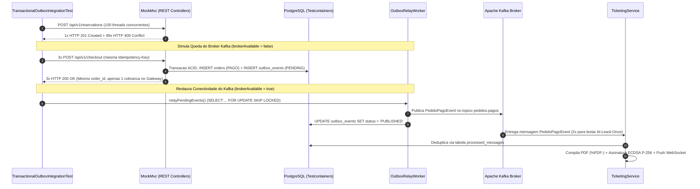

# Testes de Integracao Testcontainers e Pipeline CI

> [!abstract] Resumo da Validação de Infraestrutura Real
> Em conformidade com as diretrizes de [[01 - Processo de Desenvolvimento Suportado por IA]] e com os requisitos [[04 - Requisitos Nao-Funcionais (RNFs)#RNF-04|RNF-04]] e [[04 - Requisitos Nao-Funcionais (RNFs)#RNF-07|RNF-07]], o Pacote 3 implementa testes de integração ponta a ponta (`TransactionalOutboxIntegrationTest`) utilizando contêineres reais do [PostgreSQL](https://www.postgresql.org/) via [Testcontainers](https://testcontainers.com/) e broker [Apache Kafka](https://kafka.apache.org/), além dos workflows automatizados do GitHub Actions em `.github/workflows/`.

---

## 1. Cenarios Verificados no `TransactionalOutboxIntegrationTest`

A classe `src/test/java/com/bolsopass/integration/TransactionalOutboxIntegrationTest.java` sobe o contexto completo do Spring Boot conectado ao banco PostgreSQL e ao broker Kafka (tópicos `pedidos.pagos` e `reservas.expiradas`), validando quatro fluxos críticos de integração:

### 1.1 Autenticação REST, Rotação de Refresh Token e Detecção de Replay (`US-01` e `US-02`)
- Exercita `POST /api/v1/auth/login` validando a emissão do Access Token JWT RS256 (`expires_in: 900`) e do Refresh Token inicial.
- Exercita `POST /api/v1/auth/refresh` comprovando a rotação para um novo par de tokens.
- Reapresenta o Refresh Token antigo já rotacionado e comprova que a API retorna `HTTP 401 Unauthorized` (`TOKEN_REVOKED_OR_INVALID`), invalidando simultaneamente toda a família de tokens da sessão.

### 1.2 Concorrência HTTP REST com 100 Requisições Simultâneas (`US-05` e `RNF-02`)
- Dispara 100 chamadas HTTP `POST /api/v1/reservations` concorrentes para o assento `"VIP-99"`.
- Comprova que a camada HTTP retorna exatamente **1 resposta `HTTP 201 Created`** e **99 respostas `HTTP 409 Conflict`** com payload `"error": "SEAT_ALREADY_RESERVED"`.

### 1.3 Idempotency-Key e Resiliência do Transactional Outbox sob Queda do Kafka (`US-09` e `US-10`)
- Desativa a conectividade com o broker Kafka (`outboxRelayWorker.setBrokerAvailable(false)`) antes do pagamento.
- Submete **3 requisições HTTP `POST /api/v1/checkout` consecutivas** com o mesmo cabeçalho `Idempotency-Key`.
- Verifica que:
  1. Todas as 3 chamadas recebem `HTTP 200 OK` com exatamente o mesmo `order_id` e `status: "PAGO"`.
  2. O simulador financeiro (`PaymentGatewaySimulator`) registra **apenas 1 cobrança** (`totalChargeAttempts == 1`).
  3. Mesmo com o Kafka indisponível, o pedido encontra-se salvo como `PAGO` na tabela `orders` e o evento encontra-se salvo como `PENDING` na tabela `outbox_events`.
- Restaura a conectividade do broker (`outboxRelayWorker.setBrokerAvailable(true)`) e aciona o `OutboxRelayWorker`: o evento é lido via `FOR UPDATE SKIP LOCKED`, publicado no tópico `pedidos.pagos` do Kafka e atualizado para `PUBLISHED` com `published_at` preenchido ($0\%$ de perda de mensagens).

### 1.4 Consumo Idempotente (`processed_messages`), PDF Real e Catraca (`US-12` a `US-15`)
- Entrega o mesmo evento `PedidoPagoEvent` duas vezes ao `TicketingService`.
- Verifica que a primeira entrega registra o `message_id` na tabela relacional `processed_messages`, compila um binário PDF válido (cabeçalho `%PDF-`) com QR Code assinado via ECDSA P-256 e publica notificação WebSocket no canal `/ws/orders/{orderId}`.
- Verifica que a segunda entrega idêntica é ignorada como *no-op* sem duplicar o ingresso.
- Valida a leitura do QR Code na catraca: `AUTORIZADO` no primeiro check-in e `DUPLICATA` na tentativa seguinte.

---

## 2. Esteira de Integracao Continua (`.github/workflows/`)

Seguindo a especificação de pipeline elaborada no Pacote 2 (`04 - Pipeline de Desenvolvimento.md`) e a história `US-17`, foram implementados dois workflows automatizados no GitHub Actions:

1. **`.github/workflows/ci.yml`:** Disparado em todo `push` para `main`, `develop`, `feature/**`, `bugfix/**` e `release/**`. Configura o JDK 21 (Eclipse Temurin) com cache do Maven, executa a suíte de testes e valida o limiar mínimo de $70\%$ de cobertura no JaCoCo (`./mvnw -B -ntp clean test jacoco:report jacoco:check`), publicando o relatório HTML como artefato da build.
2. **`.github/workflows/pr-checks.yml`:** Disparado em todo *Pull Request* direcionado a `main` ou `develop`. Executa a verificação completa (`./mvnw -B -ntp clean verify`), incluindo os testes de integração com Testcontainers e a auditoria bloqueante de cobertura do JaCoCo.

