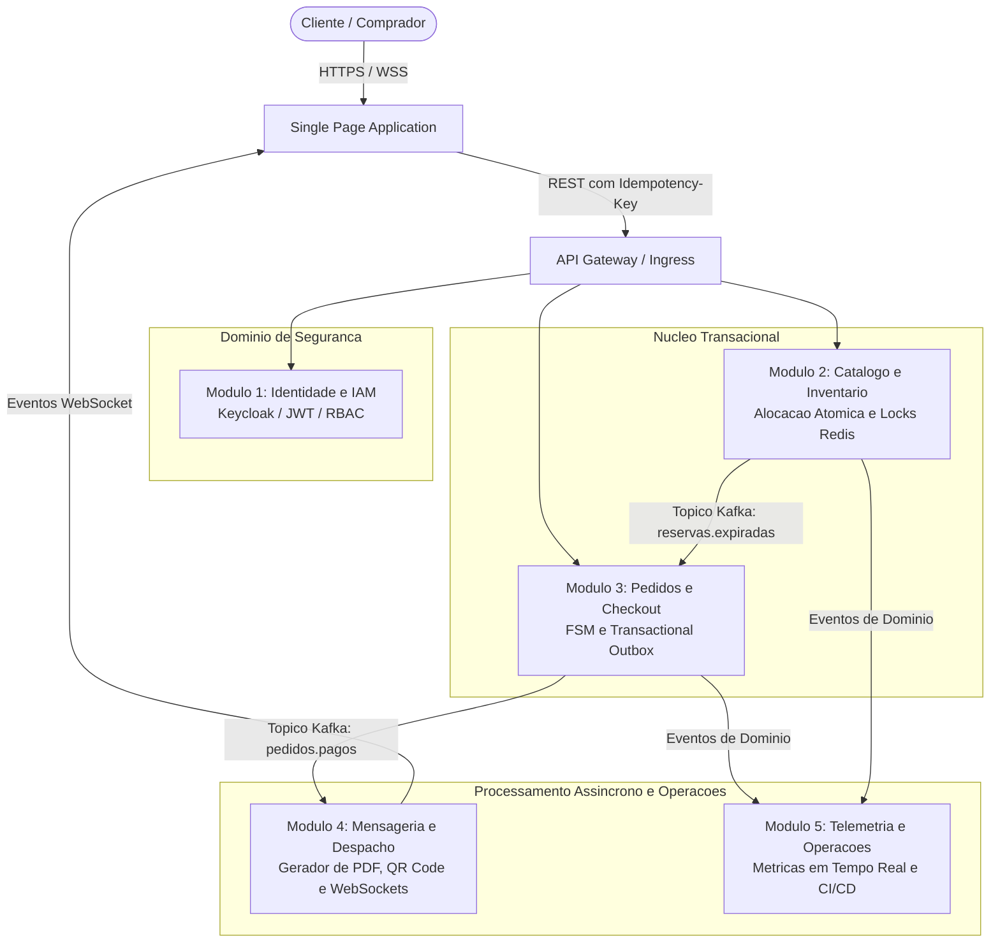

# Projeto Integrador: Plataforma BolsoPass

> [!abstract] Resumo Executivo e Contexto Acadêmico
> - **Instituição:** Pontifícia Universidade Católica do Rio Grande do Sul (PUCRS)
> - **Unidade Acadêmica:** Escola Politécnica
> - **Disciplina:** Construção de Software – Semestre 2026/2
> - **Trabalho:** Projeto Integrador de Construção de Software
> - **Tema:** Plataforma Distribuída de Bilhetagem, Reserva e Acesso para Megaeventos (*BolsoPass*)
>
> Este documento atua como o Mapa de Conteúdo (MOC) central da especificação de requisitos, organizando os fundamentos arquiteturais, as premissas de engenharia e os artefatos do projeto em uma teia interligada de conhecimento.

---

## 1. Objetivo Geral e Desafios de Engenharia

O propósito pedagógico e técnico deste projeto integrador é consolidar competências que extrapolam o desenvolvimento de sistemas transacionais convencionais baseados em requisições puramente síncronas HTTP. 

Em plataformas comerciais de bilhetagem para megaeventos esportivos e festivais internacionais, o comportamento dos usuários diverge radicalmente de um comércio eletrônico padrão. No segundo exato em que as vendas são abertas, dezenas de milhares de requisições concorrentes atingem o sistema simultaneamente — fenômeno conhecido na literatura como tráfego de rajada (*flash crowd traffic*). 

Sistemas monolíticos tradicionais baseados exclusivamente em HTTP síncrono sofrem colapso imediato nesse cenário por dois motivos fundamentais:
1. **Esgotamento de Pools de Conexão (*Connection Pool Exhaustion*):** Cada requisição HTTP aberta retém uma conexão com o banco de dados relacional enquanto aguarda validações externas ou gateways de pagamento, exaurindo a capacidade do servidor em segundos.
2. **Acoplamento Temporal:** A falha ou lentidão momentânea de um serviço satélite (como emissão de e-mails ou gateways financeiros) propaga falhas em cascata por toda a cadeia de chamadas, travando a jornada de compra do cliente.

Para mitigar esses riscos, a plataforma adota o estilo arquitetural de microsserviços orientados a eventos, utilizando o [Apache Kafka](https://kafka.apache.org/) como espinha dorsal assíncrona e bancos relacionais com garantias transacionais estritas, detalhados em [[03 - Requisitos Funcionais (5 Modulos)]] e [[04 - Requisitos Nao-Funcionais (RNFs)]].

### Premissas Críticas de Negócio

- **Tolerância Zero à Sobre-venda (*Zero Overselling*):** É matematicamente e transacionalmente inaceitável que o mesmo assento ou ingresso seja alocado para dois clientes simultâneos. A integridade do inventário é protegida por mecanismos de alocação atômica e travas distribuídas baseadas em [Redis Distributed Locks](https://redis.io/docs/latest/develop/use/patterns/distributed-locks/).
- **Expiração Estrita de Reservas (TTL de 10 Minutos):** O assento reservado permanece bloqueado para o cliente por exatamente dez minutos. Caso o checkout não seja concluído nesse intervalo, o assento é desalocado de forma atômica e devolvido ao catálogo, conforme modelado na máquina de estados em [[06 - Maquinas de Estados e Regras de Negocio]].
- **Emissão Segura e Anti-Fraude:** Todo ingresso gerado possui representação em PDF com carimbo de tempo (*timestamp*) auditável e QR Code com assinatura criptográfica assimétrica baseada na [RFC 7515 (JSON Web Signature)](https://datatracker.ietf.org/doc/html/rfc7515), viabilizando conferência confiável na portaria física mesmo em cenários offline.
- **Resiliência Transacional sem Escrita Dupla:** A consistência entre a persistência relacional do pedido e a publicação de eventos no Kafka é garantida pelo [Transactional Outbox Pattern](https://microservices.io/patterns/data/transactional-outbox.html), eliminando o risco clássico de divergência transacional (*Dual-Write Dilemma*).

---

## 2. Mapa de Conteúdo e Navegação (MOC)

Os artefatos de engenharia deste projeto foram distribuídos em notas modulares conectadas por links contextuais, cobrindo integralmente o **Pacote 1 (Processo de Desenvolvimento e Requisitos)** e pavimentando a evolução para os pacotes subsequentes da disciplina:

| Documento | Foco e Escopo Técnico | Status |
| :--- | :--- | :--- |
| [[01 - Processo de Desenvolvimento Suportado por IA]] | Framework metodológico com engenharia de contexto, especificações OpenAPI/AsyncAPI, pair programming com agentes de IA e guardrails técnicos. | Concluído |
| [[02 - Documento de Visao do Produto]] | Problema de negócio, proposta de valor, público-alvo, personas mapeadas, KPIs de sucesso e matriz de riscos. | Concluído |
| [[03 - Requisitos Funcionais (5 Modulos)]] | Especificação funcional aprofundada dos cinco módulos autônomos (IAM, Inventário, Checkout, Despacho e Telemetria). | Concluído |
| [[04 - Requisitos Nao-Funcionais (RNFs)]] | Critérios não-funcionais mensuráveis: throughput em rajada, latência, tolerância a falhas, cobertura e segurança (ISO 25010). | Concluído |
| [[05 - User Story Mapping e Backlog]] | Backlog horizontal no formato Story Mapping de Jeff Patton, com 18 User Stories completas e critérios de aceitação BDD (*Given/When/Then*). | Concluído |
| [[06 - Maquinas de Estados e Regras de Negocio]] | Máquinas de estados formais (FSM do Pedido e Reserva), especificação do Outbox Pattern e semântica do cabeçalho `Idempotency-Key`. | Concluído |
| [[07 - Mockups e Mapa de Navegacao Frontend]] | Arquitetura de informação do SPA, fluxos de navegação por papel, wireframes estruturais e protótipo interativo de alta resolução ([`mockups-high-res/index.html`](file:///home/leo/%C3%81rea%20de%20trabalho/Vault/BolsoPass/Requisitos%20do%20Projeto%20-%20BolsoPass/mockups-high-res/index.html)). | Concluído |
| [[08 - Matriz de Rastreabilidade e Pacotes de Entrega]] | Matriz bidirecional relacionando requisitos funcionais, não-funcionais, histórias de usuário e os pacotes avaliativos da PUCRS. | Concluído |
| [[Mapa Visual dos Requisitos.canvas]] | Tela visual interativa em formato Obsidian Canvas, integrando todas as notas em um grafo bidimensional com fluxos lógicos. | Concluído |

---

## 3. Visão Geral das Frentes Funcionais Autônomas

A arquitetura do BolsoPass reparte as responsabilidades do domínio em cinco serviços autônomos, minimizando acoplamento temporal e garantindo que picos de leitura no catálogo não degradem o processamento transacional de checkout:

A orquestração entre o catálogo mantido no Módulo 2 e a transação financeira processada no Módulo 3 é orquestrada por meio de eventos publicados no Kafka. O detalhamento de cada uma das cinco frentes encontra-se documentado em [[03 - Requisitos Funcionais (5 Modulos)]].

---

## 4. Estrutura dos Pacotes Avaliativos da Disciplina

O plano de entrega acadêmico está estruturado em quatro pacotes incrementais:

1. **Pacote 1 – Processo de Desenvolvimento e Requisitos:**
   Compreende a visão estratégica do produto, a descrição metodológica do processo auxiliado por inteligência artificial, o backlog mapeado em *Story Mapping*, os requisitos não-funcionais com métricas claras e os mockups navegáveis do front-end. Esse pacote é consolidado integralmente por esta pasta no cofre.
2. **Pacote 2 – Arquitetura e Infraestrutura de Desenvolvimento:**
   Elaboração da documentação arquitetural no padrão [Modelo C4](https://c4model.com/) (Contexto, Contêineres e Componentes), modelagem conceitual do banco de dados relacional, topologia do cluster [Apache Kafka](https://kafka.apache.org/), pipeline automatizada de integração contínua e disciplina de Gerenciamento da Configuração de Software (GCS).
3. **Pacote 3 – Checkpoint do Desenvolvimento:**
   Entrega intermediária contendo o estágio funcional dos microsserviços, implementação da suíte de testes unitários com cobertura de domínio $\ge 70\%$ e integração contínua validada com [Testcontainers](https://testcontainers.com/).
4. **Pacote 4 – Produto Completo:**
   Disponibilização do ecossistema integral em funcionamento, orquestrado através de arquivo `docker-compose.yml` único e documentação técnica atualizada.

Para acompanhar o cruzamento formal entre esses marcos e os artefatos produzidos, consulte a [[08 - Matriz de Rastreabilidade e Pacotes de Entrega]].
