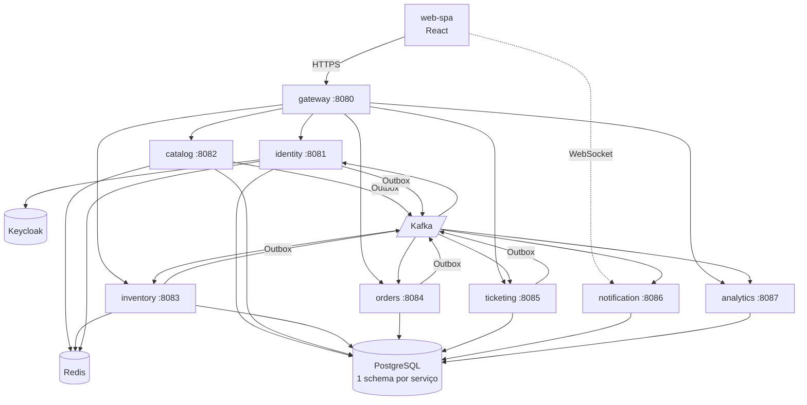

# BolsoPass — Versão 5.0: Microsserviços

> **Escopo:** dividir o backend atual (um único Spring Boot) em microsserviços que façam sentido
> para o BolsoPass, ligados por **Kafka**, com **Redis**, **Keycloak** e `docker compose up` único.
> **Data:** 01/11/2026 · **Branch:** `feat/Mocks`
> **Base:** enunciado oficial (`Projeto_Final_Construcao_Software-2026-2.pdf`, conferido item a item
> na [seção 11](#11-conferência-com-o-enunciado-pdf)) + [Requisitos Funcionais](../Requisitos%20do%20Projeto%20-%20BolsoPass/03%20-%20Requisitos%20Funcionais%20(5%20Modulos).md),
> [RNFs](../Requisitos%20do%20Projeto%20-%20BolsoPass/04%20-%20Requisitos%20Nao-Funcionais%20(RNFs).md),
> [C4](../Pacote%202%20-%20Arquitetura%20e%20Infraestrutura/01%20-%20Arquitetura%20C4.md),
> [Kafka](../Pacote%202%20-%20Arquitetura%20e%20Infraestrutura/03%20-%20Mensageria%20Kafka.md) e
> [Desenvolvimento.md](../Desenvolvimento.md).
> **Versões anteriores:** [1.0](../Versão%201.0%20-%20Implementação/README.md) (cliente) ·
> [2.0](../Versão%202.0%20-%20Implementação/README.md) (admin e login) ·
> [3.0](../Versão%203.0%20-%20Implementação/README.md) (admin pelos mockups) ·
> [4.0](../Versão%204.0%20-%20Implementação/README.md) (bilheteria).

**Status:** 🚧 em implementação: **passo 1 pronto** (01/11/2026). Decisões abertas na seção 10.

## Andamento

| Passo | Situação | O que entrou |
| :-: | :-: | :--- |
| 1 | ✅ | Outbox publica no **Kafka** de verdade; compose com Kafka, AKHQ, Redis e Mailpit; testes com **Testcontainers** |
| 2–8 | ⏳ | — |

### Passo 1: o que mudou

**Outbox → Kafka (RF-10, RNF-04)**
- [`KafkaEventPublisher`](../backend/src/main/java/com/bolsopass/outbox/KafkaEventPublisher.java):
  publica com `acks=all` e produtor idempotente, e só marca o evento como publicado depois da
  confirmação do broker.
  - Envelope do doc 03: `eventId`, `eventType`, `eventVersion`, `occurredAt`, `producer`,
    `aggregateId`, `payload`.
  - Cabeçalhos: `event-id`, `event-type`, `content-type`.
  - O `eventId` é o id da linha do Outbox, então um reenvio leva o mesmo id.
- [`EventPublisherConfig`](../backend/src/main/java/com/bolsopass/outbox/EventPublisherConfig.java):
  - `bolsopass.kafka.enabled=true` liga o Kafka. O perfil `postgres` (compose) já vem ligado.
  - Desligado, como no perfil `dev` sem Docker, o evento vai só para o log, como antes.
  - Na subida, cria os tópicos com as partições do doc 03.
- Com o Kafka fora, o produtor desiste em 3 s, o evento fica `PENDING` e sai na próxima rodada.
- `OutboxEvent.payload` passou de `@Lob` para `text`. No PostgreSQL, o `@Lob` de String vira
  `oid`, que só pode ser lido dentro de transação.

**docker-compose**
- Novos serviços:
  - Kafka 3.8 em modo KRaft;
  - **AKHQ** (UI do Kafka, exigida pelo enunciado) em http://localhost:8089;
  - Redis, que será usado a partir do passo 5;
  - Mailpit (e-mails), que será usado no passo 3, em http://localhost:8025.
- O backend espera o Kafka ficar saudável antes de subir.
- O PostgreSQL agora fica na porta **5433** do host, para não brigar com um PostgreSQL instalado
  na máquina. `POSTGRES_HOST_PORT` muda a porta. Dentro do compose nada muda.

**Testes com contêineres reais (RNF-07):**
[`ContainersIntegrationTest`](../backend/src/test/java/com/bolsopass/ContainersIntegrationTest.java)
sobe PostgreSQL 16 e Kafka 3.8 pelo Testcontainers.
- A reserva publica `reservas.criadas` no Kafka com o envelope e os cabeçalhos certos.
- **Kafka pausado durante o pagamento** (RNF-04): o pagamento é aprovado, o evento fica `PENDING`
  enquanto o broker está fora e chega ao tópico quando ele volta.
- **20 compradores, 1 assento, no PostgreSQL de verdade** (RNF-02): só 1 consegue.
- Sem Docker na máquina, a classe é pulada e o resto da suíte roda normalmente.

**Resultado**
- 51 testes passando, com 92,6% das linhas cobertas (`./mvnw test jacoco:check@check`).
- Conferido de ponta a ponta: backend no perfil `postgres` contra o compose e uma venda real pela
  tela do terminal de venda (crédito e dinheiro).
  - `reservas.criadas` e `pedidos.pagos` chegaram ao Kafka.
  - Os tópicos foram criados com 12 e 6 partições.
  - O AKHQ mostra tudo.

**Ficou para depois:** o **Flyway** foi para o passo 7. Cada serviço terá as próprias migrações no
próprio schema, e escrevê-las agora para o backend único seria trabalho jogado fora.

**Como rodar**

```bash
docker compose up -d postgres kafka akhq redis mailpit        # infraestrutura
cd backend && SPRING_PROFILES_ACTIVE=postgres ./mvnw spring-boot:run
# ou tudo junto: docker compose up --build
```

---

## 1. Por que agora

O produto funciona de ponta a ponta para os 3 perfis, mas o enunciado exige uma arquitetura
distribuída que ainda não temos:

| Exigência | Onde está no enunciado | Hoje |
| :--- | :--- | :--- |
| Estilo de microsserviços, um contêiner por serviço | Arquitetura obrigatória · RNF-08 | Um serviço só, dividido em pacotes |
| Kafka como streaming de eventos | RF-10, RF-12, RF-15 · RNF-04 | Outbox grava, mas o relay só escreve no log |
| Emissão do ingresso **assíncrona** e idempotente | RF-12, RF-13 · RNF-05 | Ingresso emitido na mesma chamada do pagamento |
| Redis: travas, refresh tokens, cache do catálogo | RF-01, RF-05, RF-06 · RNF-01 | Tudo no banco relacional |
| Keycloak (ou Cognito) | RF-01 · RNF-06 | Autenticação própria |
| PDF do ingresso + e-mail/SMS | RF-13, RF-14 | Não existe |
| Telemetria por streaming | RF-15, RF-16 | Painel lê o banco a cada 15 s |
| Testcontainers (PostgreSQL, Kafka, Redis) | RNF-07 | H2 em memória |
| `docker compose up --build` sobe tudo | RF-17 · RNF-08 | Sobe só PostgreSQL, backend e frontend |

A boa notícia: o código já foi escrito pensando nisso. Cada pacote do backend corresponde a um
serviço do C4, o Transactional Outbox, a Idempotency-Key e o QR assinado já existem e estão
testados. A versão 5.0 é **separar**, não reescrever.

---

## 2. Os serviços

Partimos dos 8 serviços do C4 (Pacote 2) e ajustamos ao que o código virou nas versões 1.0–4.0:

- a **bilheteria** (venda no balcão) e o **painel do produtor** não existiam no C4 e precisam de casa;
- a **auditoria** fica junto da identidade (quem fez o quê);
- a **sala de espera virtual** fica com o inventário, porque é ela que libera a reserva.

| # | Serviço | Porta | Responsabilidade | Banco (schema) | Redis | Requisitos |
| :-: | :--- | :-: | :--- | :--- | :-: | :--- |
| 0 | **gateway** | 8080 | Porta única da SPA: rotas, validação do JWT, rate limit, CORS | — | rate limit | RNF-01, RNF-06 |
| 1 | **identity-service** | 8081 | Login (via Keycloak), perfil (CPF, telefone), cadastro e aprovação de organizadores, operadores e vendedores, **auditoria** | `identity` | refresh tokens | RF-01, RF-02, RF-03 |
| 2 | **catalog-service** | 8082 | Eventos, setores, lotes e virada de lote, mapa de assentos (desenho), assistente de criação do produtor, catálogo público | `catalog` | cache-aside | RF-04, RF-05 |
| 3 | **inventory-service** | 8083 | Estado de cada assento, **cria a reserva** de 10 min (travas), expiração, devolução, sala de espera; publica `reservas.*` | `inventory` | travas `SETNX` + fila | RF-06, RF-07 · RNF-02, RNF-03 |
| 4 | **orders-service** | 8084 | **Consome as reservas do inventário** e cria o pedido, checkout, máquina de estados, Idempotency-Key, gateway de pagamento simulado, pagamento da **venda no balcão** (crédito, PIX, dinheiro), Outbox | `orders` | — | RF-08 a RF-11 · RNF-04, RNF-05 |
| 5 | **ticketing-service** | 8085 | Emite ingressos ao consumir `pedidos.pagos`, QR assinado ECDSA, **PDF**, carteira (inclui ingressos pelo CPF), **portaria** (base offline e sincronização de leituras) | `ticketing` | — | RF-12, RF-13 · RNF-06 |
| 6 | **notification-service** | 8086 | WebSocket para a SPA (mapa de assentos e status do pedido), **e-mail** e **SMS** simulado | `notification` | — | RF-14 |
| 7 | **analytics-service** | 8087 | Ingestão de eventos de navegação e de negócio, agregação por janela, **painel do produtor** | `analytics` | — | RF-15, RF-16 |

Além deles, **Prometheus + Grafana** coletam as métricas operacionais de todos os serviços
(`/actuator/prometheus`). O enunciado pede, no módulo de Telemetria, que se "colete métricas
operacionais", então eles sobem junto no `docker compose up`.

> **Catálogo e inventário em 2 serviços:** o enunciado junta os dois num módulo só ("Catálogo,
> Assentos e Bloqueio Concorrente"). Separamos porque o catálogo é leitura pesada (cache) e o
> inventário é escrita disputada (travas): escalam de jeitos diferentes (RNF-01). Se a memória do
> notebook apertar, os dois podem virar um serviço só sem mudar o resto do plano (seção 10).

Ficaram de fora, de propósito:

- **Serviço próprio para a bilheteria:** a venda no balcão é um checkout com outro caixa (dinheiro,
  CPF do cliente informado pelo operador). Separar duplicaria a máquina de estados do pedido.
- **Serviço de auditoria separado:** seria um serviço só para gravar logs. Os outros serviços
  publicam em `auditoria.eventos` e o identity-service grava.
- **Serviço de pagamento separado:** o gateway é simulado. Ele continua uma classe dentro de
  orders-service, atrás de uma interface, para poder virar serviço externo sem mexer no resto.

### De onde vem cada pacote atual

| Pacote hoje (`backend/.../bolsopass/`) | Vai para |
| :--- | :--- |
| `iam`, `audit` | identity-service |
| `catalog` (menos `VirtualQueue`), `organizer` (criação de evento) | catalog-service |
| `inventory`, `catalog/VirtualQueue`, `boxoffice` (reserva no balcão) | inventory-service |
| `orders`, `boxoffice` (pagamento no balcão), `organizer/SeatSalesService` (quem comprou o assento) | orders-service |
| `boxoffice` (busca e cadastro rápido por CPF) | identity-service |
| `ticketing`, `management` (portaria) | ticketing-service |
| `realtime` | notification-service |
| `organizer` (números do painel) | analytics-service |
| `outbox`, `shared` | biblioteca comum `bolsopass-commons` (usada por todos) |
| `seed` | um seed por serviço, só no perfil `dev` |

---

## 3. Visão geral



### Regra de conversa entre serviços

O enunciado abre dizendo que sistemas "estruturados exclusivamente sobre HTTP síncrono" sofrem com
"acoplamento temporal prejudicial à resiliência". Por isso:

- **Nenhum serviço chama outro por HTTP.** A SPA fala com cada serviço pelo gateway, e os serviços
  conversam **só por eventos no Kafka**, publicados pelo Outbox na mesma transação do banco.
- **Ninguém lê o banco de outro serviço.** O que um serviço precisa de outro chega dentro do evento
  e fica guardado como cópia local. Exemplos:
  - o inventory guarda o preço do lote vigente, que recebe por `eventos.publicados` e `lotes.virados`;
  - `pedidos.pagos` leva o título do evento, o setor e o CPF de cada titular, então o ticketing
    emite o ingresso sem consultar ninguém.
- **Consequência:** se o orders cair, as reservas continuam sendo feitas. Os eventos ficam no Kafka
  e o orders cria os pedidos quando voltar.

---

## 4. Eventos (Kafka)

Os nomes seguem o que o código já usa (`OutboxWriter`) e o RNF-03 (`reservas.expiradas`): em
português, no plural, com a ação no passado.

| Tópico | Produtor | Consumidores | Chave |
| :--- | :--- | :--- | :--- |
| `eventos.publicados` | catalog | inventory (cria os assentos), analytics | `event_id` |
| `lotes.virados` | catalog | notification, analytics | `event_id` |
| `reservas.criadas` | inventory | **orders (cria o pedido)**, notification (mapa ao vivo), analytics | `reservation_id` |
| `reservas.expiradas` | inventory | orders (pedido → EXPIRADO), notification, analytics | `reservation_id` |
| `reservas.liberadas` | inventory | notification, analytics | `reservation_id` |
| `pedidos.criados` | orders | analytics | `order_id` |
| `pedidos.pagos` | orders | **ticketing (emite)**, inventory (assento → VENDIDO), notification, analytics | `order_id` |
| `pedidos.cancelados` | orders | inventory (devolve), notification, analytics | `order_id` |
| `pagamentos.recusados` | orders | notification, analytics | `order_id` |
| `ingressos.emitidos` | ticketing | notification (e-mail + PDF + push), analytics | `order_id` |
| `ingressos.validados` | ticketing (leitura na portaria) | analytics (entradas no painel) | `ticket_id` |
| `auditoria.eventos` | todos | identity (grava o log) | `aggregate_id` |
| `telemetria.navegacao` | analytics (via `POST /telemetry/events`) | analytics | `session_id` |
| `_dlq.<tópico>` | consumidor que falhou 3 vezes | operação (AKHQ) | igual ao original |

O envelope, os headers, a configuração dos consumidores e a DLQ seguem o
[doc 03 do Pacote 2](../Pacote%202%20-%20Arquitetura%20e%20Infraestrutura/03%20-%20Mensageria%20Kafka.md).
O doc 03 usa nomes em inglês (`reservation.created`…); ele será atualizado para os nomes acima.

**Idempotência no consumo (RNF-05):** todo consumidor grava o `eventId` em `processed_messages`
na mesma transação da regra de negócio. Mensagem repetida vira no-op. Fica na biblioteca comum,
então ninguém precisa reimplementar.

---

## 5. Os fluxos principais, passo a passo

### 5.1 Compra online (cliente)

1. SPA → gateway → **inventory** `POST /reservations`.
2. inventory trava os assentos por 10 min: Redis `SETNX` com TTL mais `SELECT … FOR UPDATE` no
   PostgreSQL. As duas travas juntas mantêm o zero overselling mesmo se o Redis cair (RNF-02).
3. Na mesma transação, inventory grava a reserva e `reservas.criadas` (Outbox). O id do pedido já
   nasce aqui e vai no evento. Assim a resposta à SPA traz reserva + pedido em `RESERVADO`, como hoje.
4. **orders** consome `reservas.criadas` e cria o pedido com esse id, de forma idempotente.
   notification avisa todos os mapas abertos que o assento ficou ocupado.
5. SPA → **orders** `POST /checkout` com Idempotency-Key. O pagamento é aprovado: pedido `PAGO` e
   `pedidos.pagos` gravados na mesma transação (Outbox).
   - Se o checkout chegar antes do evento (milissegundos; o cliente leva segundos preenchendo),
     orders responde `409 pedido em criação` e a SPA tenta de novo sozinha.
6. **ticketing** consome `pedidos.pagos`, emite os ingressos com QR assinado e PDF e publica
   `ingressos.emitidos`.
7. **inventory** consome `pedidos.pagos` e marca os assentos como VENDIDOS.
8. **notification** consome `ingressos.emitidos`, envia o e-mail com o PDF e avisa a SPA pelo
   WebSocket. A tela de confirmação troca "Emitindo seus ingressos…" pelos ingressos.

Se o tempo acabar antes do pagamento, inventory publica `reservas.expiradas`, orders muda o pedido
para `EXPIRADO` e o mapa libera o assento sozinho.

### 5.2 Venda no balcão (bilheteria / terminal de venda)

Mesmo fluxo da compra online. A tela da bilheteria chama cada serviço pelo gateway em
`/operator/box-office/*`:

- a busca por CPF e o cadastro rápido vão para o **identity**;
- a reserva vai para o **inventory**, em nome do cliente e sem passar pela sala de espera;
- o pagamento vai para o **orders**, e dinheiro é aceito só neste caminho;
- `pedidos.pagos` leva o CPF de cada titular, e a carteira do cliente (ticketing) mostra os
  ingressos pelo CPF, como já acontece hoje.

### 5.3 Portaria

A portaria baixa do **ticketing** a chave pública e a lista de ingressos do evento para validar
sem internet. As leituras sincronizadas viram `ingressos.validados`, e o painel do produtor
atualiza a contagem de entradas via **analytics**.

### 5.4 Painel do produtor

O **analytics** soma os eventos (vendas, receita, reservas, entradas, abandono) por janela de
1 minuto e 1 hora. O painel deixa de consultar o banco de pedidos a cada 15 s e passa a receber
as atualizações pelo WebSocket (RF-16).

---

## 6. Login com Keycloak sem mudar as telas

Decidido nas versões anteriores: **a tela de login continua a nossa** (web e responsiva), com os
botões de acesso rápido e o login da bilheteria por matrícula + PIN.

- O Keycloak tem um realm `bolsopass` com os papéis `CLIENT`, `ORGANIZER`, `ADMIN`, `OPERATOR`
  e `SELLER`. CPF e telefone ficam como atributos do usuário e vão no token.
- O **identity-service** mantém os endpoints `/auth/login`, `/auth/operator-login`,
  `/auth/refresh` e `/auth/logout`. Por trás, troca as credenciais por tokens no Keycloak. Os
  refresh tokens ficam no Redis, com rotação e detecção de reuso como hoje.
- Matrícula e PIN de operador e vendedor são o usuário e a senha dessas contas no Keycloak.
- O **gateway** e cada serviço validam o JWT pela chave pública do Keycloak (JWKS). Nenhum serviço
  guarda senha.

Com isso **o frontend não muda**: os mesmos caminhos `/api/v1/...` passam pelo gateway, e o modo
mock (`VITE_USE_MOCKS`) continua igual para desenvolver sem backend.

> **Ponto de atenção:** trocar senha por token pelo backend é o fluxo *Direct Access Grant*. O
> OAuth 2.1 desaconselha esse fluxo, mas ele mantém a nossa tela. Fica habilitado só para o
> cliente `bolsopass-bff` do realm. A alternativa é a tela de login do próprio Keycloak (fluxo
> com PKCE), mais "correta", mas ela troca a identidade visual que construímos.

---

## 7. Estrutura do repositório

```
backend/
├── pom.xml                      ← pai (Maven multi-módulo, Java 25, Spring Boot 3.5)
├── libs/
│   └── bolsopass-commons/       ← Outbox, processed_messages, envelope, erros, segurança JWT
├── services/
│   ├── gateway/
│   ├── identity-service/
│   ├── catalog-service/
│   ├── inventory-service/
│   ├── orders-service/
│   ├── ticketing-service/
│   ├── notification-service/
│   └── analytics-service/
└── infra/
    ├── keycloak/realm-bolsopass.json
    └── postgres/init-schemas.sql
```

- Cada serviço tem `Dockerfile`, migrações **Flyway** no próprio schema, testes e meta de JaCoCo
  ≥ 70%.
- O `docker-compose.yml` passa a subir: gateway, 7 serviços, web-spa, PostgreSQL, Redis, Kafka
  (KRaft), AKHQ (UI do Kafka), Keycloak, MailHog (caixa de e-mail falsa para ver o comprovante),
  Prometheus e Grafana.
- **Memória:** são 8 JVMs + Kafka + Keycloak num notebook. Cada serviço roda com `-Xmx256m`.

---

## 8. Ordem de implementação

Separar tudo de uma vez quebraria o sistema por dias. A ideia é tirar **um serviço por vez**
(padrão *Strangler*): o backend atual continua respondendo o que ainda não saiu dele. Ao fim de
cada passo, os testes passam, `docker compose up` funciona e o frontend roda sem mudança.

| Passo | O que muda | Por que nesta ordem | Requisitos fechados |
| :-: | :--- | :--- | :--- |
| **1** ✅ | Kafka, Redis, AKHQ e Mailpit no compose. O relay do Outbox passa a publicar no Kafka de verdade. Testcontainers nos testes de integração. (Flyway foi para o passo 7.) | Base para todo o resto; nada quebra | RF-10 completo, RNF-04, RNF-07 |
| **2** | Maven multi-módulo + `bolsopass-commons` + **gateway** na frente do backend atual (todas as rotas para ele) | A SPA já passa a falar só com o gateway | RNF-08 (parcial) |
| **3** | **notification-service** (WebSocket + e-mail) e **analytics-service** (painel) + Prometheus/Grafana | Só consomem eventos: menor risco | RF-14, RF-15, RF-16 |
| **4** | **ticketing-service**: emissão assíncrona por `pedidos.pagos`, PDF, portaria | É o coração do RF-12 e do RF-13 | RF-12, RF-13, RNF-05 |
| **5** | **Keycloak** + **identity-service** (login, perfis, organizadores, auditoria) | Precisa do gateway pronto (passo 2) | RF-01, RF-02, RF-03, RNF-06 |
| **6** | **catalog-service** com cache Redis | Depende do identity para o produtor | RF-04, RF-05, RNF-01 |
| **7** | Separar **inventory-service** e **orders-service**; o backend atual deixa de existir. Flyway por serviço | O mais difícil: hoje inventário e pedidos se chamam nos dois sentidos | RF-06 a RF-09, RF-11, RNF-02, RNF-03 |
| **8** | CI no GitHub Actions: lint, testes e build por serviço (só os que mudaram) em cada PR e merge na `develop`; teste de carga k6 (bônus) | Fecha o RNF-08 | RF-18, RNF-01 (bônus) |

### O nó do passo 7

Hoje `inventory` importa `orders`: a reserva cria o pedido, e o job de expiração muda o pedido
para EXPIRADO. `orders` também importa `inventory`. Na separação, seguimos o enunciado ("Pedidos
**consome reservas do Inventário**"; Inventário "**publica eventos de expiração** no broker"):

- **a reserva vira evento**: inventory publica `reservas.criadas` e orders cria o pedido;
- **a expiração vira evento**: inventory publica `reservas.expiradas` e orders muda o pedido para EXPIRADO;
- o id do pedido nasce na reserva, então a resposta de `/api/v1/reservations` continua igual e o
  frontend não percebe a mudança.

O diagrama de sequência do doc 03 do Pacote 2 mostra o orders chamando o inventory direto. Ele
será corrigido para este fluxo.

---

## 9. Como vamos provar que funciona

| Teste | Onde | Prova |
| :--- | :--- | :--- |
| Unitários da máquina de estados (já existem, 19) | orders | RF-08 |
| 20 compradores no mesmo assento, só 1 consegue (já existe) | inventory, agora com Redis + PostgreSQL reais | RNF-02 |
| Reserva expira em 10 min ± 1 s e publica `reservas.expiradas` | inventory + Kafka (Testcontainers) | RNF-03 |
| Kafka **pausado** durante o pagamento; o evento sai quando ele volta | orders + Kafka (Testcontainers) | RNF-04 |
| Mesmo `pedidos.pagos` entregue 2 vezes emite os ingressos 1 vez só | ticketing | RNF-05 |
| Mesma Idempotency-Key 2 vezes cobra 1 vez só (já existe) | orders | RF-09 |
| Jornada completa pelo gateway: login → compra → ingresso → e-mail no MailHog → leitura na portaria | CI, com o compose de pé | RF-17, RNF-08 |
| Testes do frontend (78 hoje) continuam passando sem mudança | web-spa | contrato da API preservado |

---

## 10. Decisões para o grupo confirmar

1. **Nomes dos tópicos em português** (como o código e o RNF-03), atualizando o doc 03 do Pacote 2,
   que está em inglês.
2. **Manter a nossa tela de login** com o Keycloak por trás (Direct Access Grant), em vez da tela
   do Keycloak (seção 6).
3. **Um PostgreSQL com um schema por serviço**, como decidido no C4, em vez de um banco por
   serviço. Isola os dados igual e gasta menos memória.
4. **Venda no balcão sem serviço próprio**: busca por CPF no identity, reserva no inventory e
   pagamento no orders (seção 5.2).
5. **Catálogo e inventário separados** (seção 2), ou juntos como no módulo do enunciado, se a
   memória apertar.
6. **Atualizar a documentação dos Pacotes 1 e 2**, exigida nos Pacotes 3 e 4:
   - C4: bilheteria, portaria, terminal de venda, `ROLE_SELLER`, Prometheus/Grafana e os nomes
     `identity` e `analytics`;
   - doc 03 (Kafka): nomes dos tópicos e o fluxo da reserva por evento;
   - modelo de dados: um schema por serviço;
   - pipeline: CI por serviço.

---

## 11. Conferência com o enunciado (PDF)

✅ coberto pelo plano · ✔️ já existe no código hoje

### Requisitos funcionais

| Módulo do enunciado | O que pede | Onde fica no plano |
| :--- | :--- | :--- |
| **IAM** | JWT stateless com refresh tokens em chave-valor | ✅ identity + Keycloak; refresh tokens no Redis (seção 6) |
| | RBAC: Cliente, Organizador, Operador, Admin | ✔️ já existe; no Keycloak vira papel do realm. Temos também `SELLER` (terminal de venda), um operador que só vende |
| | Auditoria de credenciais e gestão cadastral de organizadores | ✅ identity: log de login e cadastro/aprovação de organizadores |
| | *Integração:* segurança e assinatura de tokens para todas as rotas | ✅ gateway e cada serviço validam o JWT pela chave do Keycloak |
| **Inventário** | Lotes e mapas de assentos | ✔️ assistente do produtor → catalog |
| | Catálogo de alta leitura | ✅ catalog com cache Redis |
| | Alocação e devolução atômicas (cancelamento ou timeout) | ✔️ já testado (20 compradores, 1 assento) → inventory, agora com Redis |
| | *Integração:* valida identidade com o IAM | ✅ JWT do Keycloak |
| | *Integração:* emite locks concorrentes | ✅ Redis `SETNX` + `FOR UPDATE` |
| | *Integração:* publica eventos de expiração no broker | ✅ `reservas.expiradas` |
| **Pedidos** | Máquina de estados (Criado, Reservado, Aguardando, Pago, Expirado) | ✔️ 19 testes → orders |
| | Idempotency-Key no cabeçalho HTTP | ✔️ → orders |
| | Transactional Outbox ACID publicando no Kafka | ✔️ Outbox existe; ✅ publicação real no Kafka (passo 1) |
| | *Integração:* consome reservas do Inventário | ✅ orders consome `reservas.criadas` (seção 5.1) |
| | *Integração:* simulador de gateway financeiro | ✔️ → orders |
| | *Integração:* despacha eventos atômicos ao Kafka | ✅ `pedidos.*` pelo Outbox |
| **Despacho** | Consumo assíncrono de pagamentos confirmados | ✅ ticketing consome `pedidos.pagos` |
| | PDF com carimbo de tempo e QR Code | ✔️ QR assinado; ✅ PDF no ticketing |
| | Comprovantes multicanal + tela em tempo real | ✔️ WebSocket; ✅ e-mail (MailHog) e SMS simulado no notification |
| **Telemetria e DevOps** | Ingestão e agregação contínua de eventos de navegação e compras | ✅ analytics (`telemetria.navegacao` + tópicos de domínio) |
| | Painel analítico em tempo real | ✅ painel do produtor via analytics + WebSocket |
| | CI/CD e Docker Compose | ✅ passos 1, 2 e 8 |
| | *Integração:* coleta métricas operacionais | ✅ Prometheus + Grafana |

### Aspectos de arquitetura

| Exigência | Onde fica no plano |
| :--- | :--- |
| Estilo arquitetural de microsserviços | ✅ 7 serviços + gateway (seção 2) |
| Keycloak ou Cognito | ✅ Keycloak (seção 6) |
| Kafka como streaming em tempo real | ✅ seção 4 |
| Dual-Write Dilemma | ✔️ Outbox; ✅ teste com o Kafka pausado (seção 9) |
| Idempotência no consumo | ✅ `processed_messages` na biblioteca comum (seção 4) |
| Processo de desenvolvimento com IA documentado | ✔️ Pacote 1, doc 01 |
| C4 nível 1: comprador, organizador, operador; gateways bancários e e-mail | ✔️ Pacote 2; ✅ atualizar (seção 10) |
| C4 nível 2: SPA, APIs, PostgreSQL/Redis, Kafka, **servidores WebSocket** | ✅ notification é o servidor WebSocket |
| C4 nível 3: controladores, casos de uso, repositórios, **workers do Outbox**, **consumidores** | ✅ cada serviço segue esse corte |

### Testes e DevOps

| Exigência | Onde fica no plano |
| :--- | :--- |
| Unitários das máquinas de estado, ≥ 70% de cobertura de domínio | ✔️ hoje 91% (backend); ✅ JaCoCo ≥ 70% em cada serviço |
| Integração com Testcontainers: PostgreSQL e Kafka (e Redis) | ✅ passo 1 |
| Teste de carga (bônus) | ✅ k6 no passo 8 |
| Processo de GCS (ferramenta, branches, regras) | ✔️ Pacote 2, doc 05. Falta **aplicar**: commitar e criar a `develop` |
| `docker-compose.yml` com backend, frontend, bancos, Kafka e **UI de mensageria** | ✅ AKHQ (seção 7) |
| CI no GitHub Actions com lint, testes e build a cada PR ou merge na `develop` | ✅ passo 8 |

### Entregáveis

| Pacote | Situação |
| :--- | :--- |
| 1 e 2 (documentação) | ✔️ entregues; precisam ser atualizados (seção 10, item 6) |
| 3 (checkpoint: link do repositório + docs atualizadas) | Código pronto localmente, mas **não commitado**. Isso vem antes do passo 1 |
| 4 (produto completo) | Este plano inteiro |
